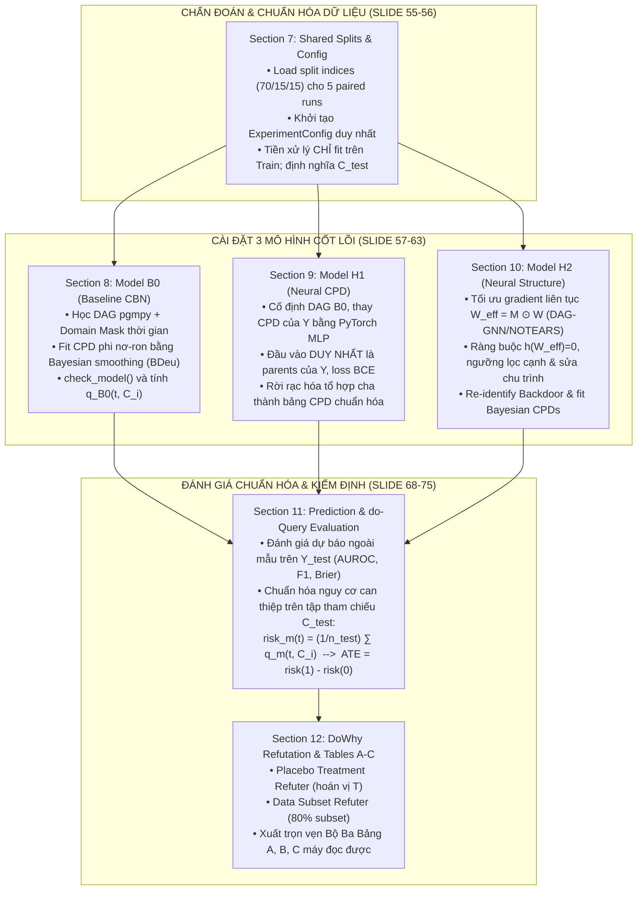

# Kế hoạch Review Notebook EDA & Khung Chuyển Tiếp Causal Modeling

> **Tài liệu tham chiếu chuẩn hóa:** `HK1_2026_IT701100_Mô hình đồ thị có xác suất_N01.pdf` (80 slides hoàn chỉnh)  
> **Slide trọng tâm:** Slide 51, 53–56 (Data Audit & Splits), Slide 57–63 (B0, H1, H2), Slide 68–71 (Paired Runs & Refutation), Slide 74–75 (Tables A–C), Slide 76–77 (Colab Structure & 6-step Demo), Slide 79 (Failure Handling).  
> **Bộ dữ liệu thực nghiệm:** UCI Machine Learning Repository ID 697 (Student Dropout and Academic Success).

---

## 1. Kết luận nhanh về Notebook hiện tại

### Quy tắc Markdown/KaTeX cho notebook

Không đặt khối `$$...$$` trên cùng dòng với `>` hoặc văn bản Markdown. Dùng
đúng cấu trúc tách dòng:

```markdown
> Mục tiêu là ước lượng ATE:

$$
\mathrm{ATE}
= \mathbb{E}[Y \mid \mathrm{do}(T=1)]
- \mathbb{E}[Y \mid \mathrm{do}(T=0)]
$$

**Kiến trúc thực nghiệm:**
```

Không dùng dạng dễ gây lỗi:

```markdown
> $$\text{ATE} = ...$$
> **Kiến trúc thực nghiệm:**
```

Trong công thức, ưu tiên `\mathrm{do}` thay cho `\text{do}` để tương thích
với renderer KaTeX của VS Code. Mỗi khối `$$...$$` phải có dòng mở và đóng
riêng, không đặt giữa một đoạn blockquote.

Notebook [eda_uci697_kaggle_s4e6.ipynb](../../notebook/eda_uci697_kaggle_s4e6.ipynb) hiện tại đóng vai trò là **Notebook Tiền xử lý, EDA và Causal-Readiness Audit** (kiểm toán độ sẵn sàng nhân quả) cho dữ liệu bảng UCI 697.

### Những điểm chuẩn xác đã đạt được:
1. **Phân lập phạm vi rõ ràng**: Notebook tập trung hoàn toàn vào việc khám phá dữ liệu, đánh giá chất lượng và kiểm toán tiền điều kiện nhân quả trước khi mô hình hóa (pre-requisite audit).
2. **Tuân thủ nghiêm ngặt nguyên tắc Causal Inference**:
   * **Lọc bỏ cohort `Enrolled`**: Giữ lại 3,630 dòng (`Graduate=1`, `Dropout=0`) để đảm bảo biến outcome $Y$ nhị phân rõ ràng, không lẫn lộn trạng thái trung gian.
   * **Kiểm tra Leakage & Phân định trật tự thời gian**: Phát hiện và loại bỏ các biến kết quả học tập kỳ 1 & 2 (`Curricular units 1st/2nd sem`) khỏi tập điều chỉnh nền tại thời điểm nhập học (tránh Post-treatment bias / Mediator leakage).
   * **Kiểm toán Positivity / Treatment Overlap**: Đánh giá sự hiện diện của cả 2 nhóm can thiệp ($T=0$ và $T=1$) trên các tầng biến nhiễu nền $Z$ (học bổng, nợ học phí, học phí đúng hạn, điểm nhập học, tuổi).
   * **Định hướng đúng vai trò của EDA**: Tuyệt đối không dùng Mutual Information hay Correlation để tự động gán chiều mũi tên nhân quả.

### Điểm cần làm rõ về "Synthetic Benchmark" (Giải tỏa áp lực):
* *Quy định chính thức từ Slide 44, 51, 53 & 75:*
  > *"The tutoring walkthrough explains concepts only. The project has no synthetic-data generation or synthetic verification requirement. The graded project uses UCI data."*
* Bài toán mô phỏng phụ đạo (Synthetic Tutoring Benchmark $ATE=0.30$) chỉ mang tính chất minh họa phương pháp trên lớp học. Sản phẩm thực nghiệm chính thức tập trung 100% vào bộ dữ liệu bảng UCI 697. Phần Synthetic và Ablations A1–A3 được xem là **phần mở rộng tùy chọn (Optional Extensions)** đưa vào Phụ lục, không phải là phần thiếu hụt của bài toán bắt buộc.

---

## 2. Review theo từng mục của Notebook EDA hiện tại

| Mục hiện tại | Nội dung đang thực hiện | Tiêu chí Review cần kiểm tra | Output / Artifacts cần bàn giao |
|---|---|---|---|
| **1. Environment & Paths** | Import thư viện, thiết lập đường dẫn và config | Chạy độc lập trên Colab/Jupyter; không phụ thuộc biến global state ẩn | Package versions report, data path |
| **2. Load UCI / Kaggle** | Tải dữ liệu UCI 697 từ URL chính thức và phát hiện Kaggle S4E6 | Đúng URL UCI (ID 697); Kaggle chỉ để so sánh đối chiếu, tuyệt đối không gộp chung vào UCI | `uci_shape`, source record, load status |
| **3. Data Audit** | Schema, dtype, missing values, duplicates, ID, target | Xác nhận 4,424 dòng gốc, 36 thuộc tính, 0 giá trị missing; tính checksum file | `data_audit.json` |
| **4. Treatment, Outcome & Overlap** | Kiểm tra phân bố $T$, $Y$ và kiểm toán tính bao phủ (Positivity) | Đã lọc bỏ `Enrolled` (còn 3,630 dòng); kiểm tra đủ cả 2 nhóm $T=0/T=1$ trên các tầng $Z$ | Overlap contingency tables, sparse cells flag |
| **5. Main EDA Plots** | Trực quan hóa phân bố điểm nhập học, học bổng, độ tuổi và tỷ lệ tốt nghiệp | Các biểu đồ chỉ mang tính mô tả quan sát, không được kết luận thành hiệu ứng nhân quả | PNG figures lưu trong `figures/` |
| **6. Deep Causal-Readiness Audit** | Kiểm tra rò rỉ (leakage), mất cân bằng, outlier, tương quan và mutual information | Không dùng MI/correlation để tự động gán chiều DAG; khẳng định 5 biến nền $Z_1..Z_5$ đo trước $T$ | Causal readiness report |
| **7. [MỚI BỔ SUNG] Freeze & Export Splits** | **Tạo và đóng băng phân chia Train/Val/Test (70/15/15) qua ít nhất 5 paired runs** | Đảm bảo phân tầng theo $Y$ và $T$; lưu chỉ số dòng cố định để các mô hình sau dùng chung | `splits/split_seed_*.json`, `split_summary.json` |

---

## 3. Khung Chuyển Tiếp Chuẩn Hóa cho Causal Modeling Notebook (Sections 7–12)

Để quy trình nghiên cứu liền mạch, toàn bộ phần thực nghiệm mô hình hóa sẽ được tổ chức trong notebook tiếp theo (ví dụ: `notebook/causal_bn_uci697.ipynb` hoặc tiếp nối theo module) tuân thủ đúng chuẩn **Slide 53–77**:



### Chi tiết từng Section mô hình hóa:

#### Section 7: Shared Splits & Unified Config Object (Slide 56, 76)
- **Công việc:**
  * Đọc các file chỉ số chia tập `splits/split_seed_*.json` (tỷ lệ 70% Train / 15% Validation / 15% Test) đã được sinh ra từ bước cuối của EDA.
  * Khởi tạo đối tượng cấu hình duy nhất `ExperimentConfig(seeds=(42, 123, 456, 789, 1011), ...)` dùng chung xuyên suốt notebook.
  * Đóng gói tiền xử lý (rời rạc hóa, mã hóa): **Chỉ fit trên tập Train của từng seed**, sau đó transform cho Validation và Test.
  * Định nghĩa trước tập hiệp biến nền tiền can thiệp $C = \{Z_1, Z_2, Z_3, Z_4, Z_5\}$ trên tập Test ($C_{\text{test}}$) làm quần thể tham chiếu nhân quả chung.
- **Output:** `train_df`, `val_df`, `test_df`, `C_test`, `ExperimentConfig`.

#### Section 8: Model B0 Implementation — Baseline CBN (Slide 57, 59)
- **Công việc:**
  * Học cấu trúc DAG trên tập Train bằng thuật toán truyền thống (`pgmpy` HillClimbSearch với BDeu score hoặc PC algorithm) kết hợp ma trận cấm cạnh thời gian (cấm $Y \rightarrow T$, $Y \rightarrow Z$, $T \rightarrow Z$).
  * Khởi tạo `DiscreteBayesianNetwork` và khớp tham số bằng `BayesianEstimator(prior_type="BDeu", equivalent_sample_size=5)`.
  * Thực thi `check_model()` để kiểm tra tính hợp lệ của phân phối.
  * Tính xác suất quan sát $P(Y=1 \mid T=t)$ qua `VariableElimination` để đối chiếu.
  * Định nghĩa hàm tính nguy cơ điều kiện $q_{\text{B0}}(t, C_i) = P_{\text{B0}}(Y=1 \mid T=t, C_i)$ cho từng cá nhân $i \in C_{\text{test}}$.
- **Output:** `b0_model`, `b0_dag`, cấu hình CPD, `q_b0`.

#### Section 9: Model H1 Implementation — Neural CPD on Fixed DAG (Slide 60, 61)
- **Công việc:**
  * Sao chép chính xác cấu trúc DAG của B0 cho từng run ghép cặp.
  * Xây dựng mạng nơ-ron PyTorch MLP để học phân phối điều kiện của $Y$. **Đầu vào duy nhất là các nút cha trực tiếp của $Y$** ($\text{Parents}(Y) = \{T, Z_1..Z_5\}$).
  * Huấn luyện mạng với Binary Cross-Entropy (BCE) loss, điều chuẩn Dropout, và cơ chế dừng sớm (Early Stopping) trên tập Validation; lưu checkpoint trọng số tối ưu.
  * Liệt kê tất cả các tổ hợp giá trị rời rạc của các nút cha để suy ra bảng xác suất nơ-ron đã chuẩn hóa (tổng xác suất theo $Y$ bằng 1.0), sau đó nạp lại vào bản sao mạng Bayes của B0.
  * Tính nguy cơ điều kiện $q_{\text{H1}}(t, C_i) = P_{\text{H1}}(Y=1 \mid T=t, C_i)$ cho từng cá nhân $i \in C_{\text{test}}$.
- **Output:** `h1_model.pt`, loss curves, bảng CPD nơ-ron, `q_h1`.

#### Section 10: Model H2 Implementation — Neural Causal Discovery (Slide 62, 63)
- **Công việc:**
  * Cài đặt thuật toán học cấu trúc bằng tối ưu hóa gradient liên tục (DAG-GNN hoặc nonlinear NOTEARS) trên cùng các biến và tập Train như B0.
  * **Áp dụng ma trận mặt nạ cạnh cấm $M$ (Slide 63):**
    $$W_{\text{eff}} = M \odot W, \quad M_{ij} = 0 \text{ nếu cạnh } i \rightarrow j \text{ vi phạm trật tự thời gian}, \quad M_{ii} = 0$$
  * Duy trì hàm phạt phi chu trình $h(W_{\text{eff}}) = \text{Tr}(e^{W_{\text{eff}} \circ W_{\text{eff}}}) - d = 0$.
  * Áp dụng ngưỡng lọc trọng số cạnh (edge thresholding) trên tập Validation; thực thi quy tắc sửa chu trình (cycle repair) nhất quán nếu xuất hiện chu trình.
  * Sử dụng `DoWhy` để tái nhận diện công thức Backdoor trên đồ thị H2 học được; khớp CPDs phi nơ-ron bằng `BayesianEstimator(BDeu)` như B0.
  * Nếu thuật toán không hội tụ hoặc sinh đồ thị không thể định danh, ghi nhận trung thực trạng thái `status="failed"` theo Slide 79.
- **Output:** `w_matrix`, `h2_dag`, `re_identification_status`, `q_h2`.

#### Section 11: Prediction & do-Query Evaluation (Slide 61, 68–69, 74–75)
- **Công việc:**
  * **Đánh giá dự báo ngoài mẫu (Prediction Evaluation):**  
    Sử dụng nhãn thực tế $Y_{\text{test}}$ để chấm điểm dự báo của cả 3 mô hình B0, H1, H2: AUROC, Macro-F1 (ngưỡng xác định từ tập Validation), Brier Score (hoặc Log Loss). Tính chênh lệch ghép cặp có dấu ($H_1 - B_0$, $H_2 - B_0$).
  * **Chuẩn hóa can thiệp trên tập tham chiếu (Intervention Standardization - Slide 61):**  
    Với từng mô hình $m \in \{B_0, H_1, H_2\}$, tính hiệu ứng trên cùng tập tham chiếu $C_{\text{test}}$:
    $$\text{risk}_m(t) = \frac{1}{n_{\text{test}}} \sum_{i \in \text{TEST}} q_m(t, C_i), \quad \text{ATE}_m = \text{risk}_m(1) - \text{risk}_m(0)$$
    *(Nhắc lại: Nhãn thực tế $Y_{\text{test}}$ tuyệt đối không tham gia vào phép tính ATE này).*
  * Ước lượng độ bất định: Tính khoảng tin cậy 95% Confidence Interval (Bootstrap hoặc Delta method) qua 5 runs ghép cặp.
- **Output:** `prediction_metrics_df`, `standardized_intervention_df`.

#### Section 12: DoWhy Refutation & Final Tables A, B, C (Slide 70–71, 74–75)
- **Công việc:**
  * **Kiểm định bác bỏ DoWhy (DoWhy Refutation Protocol):**
    1. `placebo_treatment_refuter`: Hoán vị ngẫu nhiên nhãn can thiệp $T$; kiểm tra hiệu ứng ước lượng có triệt tiêu về gần 0 ($p > 0.05$) hay không.
    2. `data_subset_refuter`: Lấy mẫu lại 80% tập dữ liệu để đánh giá tính ổn định mẫu của hiệu ứng can thiệp.
  * **Tổng hợp và xuất Bộ Ba Bảng Kết quả Bắt buộc (Slide 74–75):**
    * **Bảng A (Prediction):** B0, H1, H2 qua từng run và hàng Mean $\pm$ Std; AUROC, F1, Brier, $\Delta_{\text{Model}-B_0}$, Fit time, Predict time, Hardware.
    * **Bảng B (Intervention):** Cohort $C_{\text{test}}$, công thức định danh, $\text{risk}(0)$, $\text{risk}(1)$, $\widehat{\text{ATE}}$, 95% CI và phương pháp tính.
    * **Bảng C (Robustness & Cost):** Kết quả Placebo refuter, Subset refuter, độ tản mạn hiệu ứng 5 runs ($\text{Max} - \text{Min}$), $\Delta_{\text{ATE}}$, tổng runtime, cấu hình phần cứng.
  * **Phần mở rộng tùy chọn (Optional Extensions - Lưu vào Phụ lục):**
    * Thí nghiệm bóc tách A1 (bỏ dropout), A2 (mở 1 cạnh cấm), A3 (thay BDeu bằng MLE) $\rightarrow$ `optional_table_ablations.csv`.
    * Thí nghiệm Synthetic Tutoring Benchmark ($ATE_{\text{true}} = 0.30$) và DoWhy GCM simulation $\rightarrow$ `optional_table_synthetic.csv`.
- **Output:** `table_a.csv`, `table_b.csv`, `table_c.csv`, `refutations.json`.

---

## 4. Kịch bản Demo 6 Bước Trực tiếp trên Google Colab (Slide 77)

Notebook phải được thiết kế để khi báo cáo Midterm online, nhóm có thể chia sẻ màn hình Colab và demo thông suốt theo đúng 6 bước:

```text
1. Nêu câu hỏi nhân quả UCI, trật tự thời gian, đồ thị & giả định; chỉ rõ tập tham chiếu C_test và hai mức T=0, T=1.
2. Minh chứng phân định dữ liệu: TRAIN (fit), VALIDATION (chọn stopping/ngưỡng), TEST (đánh giá dự báo & chuẩn hóa can thiệp).
3. Cho xem khối mạng nơ-ron H1; mở ma trận mask M và đồ thị DAG học được của H2 kèm kết quả DoWhy identify.
4. Chọn vài profile cá nhân C_i từ Test, hiển thị q_m(0, C_i) và q_m(1, C_i); chạy lệnh lấy trung bình trên C_test để tính risk(t) và ATE.
5. Trình chiếu Bảng A (dự báo TEST), Bảng B (can thiệp & 95% CI), Bảng C (độ ổn định, DoWhy Placebo/Subset refuters & runtime).
6. Phân tích 1 ca thất bại / kết quả rỗng / giới hạn nhân quả theo Slide 79 và truy vết trực tiếp về file config và dòng code.
```

---

## 5. Checklist Review Khi Hoàn Thành Notebook

- [ ] **Tính độc lập & tái lập:** `Restart Runtime and Run All` từ cell đầu đến cell cuối không phát sinh bất kỳ lỗi nào.
- [ ] **Quản lý cấu hình:** Sử dụng duy nhất một đối tượng `ExperimentConfig`, không tồn tại biến toàn cục ẩn hoặc state phụ thuộc thứ tự chạy cell.
- [ ] **Đóng băng phân chia dữ liệu:** File `splits/split_seed_*.json` (70/15/15) được tạo từ EDA và được nạp cố định cho cả 3 mô hình B0, H1, H2.
- [ ] **Tách biệt tiền xử lý:** Toàn bộ phép mã hóa, chuẩn hóa chỉ được `fit` trên tập Train của từng seed.
- [ ] **Bảo vệ tính định danh:** Đồ thị DAG B0 và ma trận mặt nạ $M$ của H2 tuân thủ nghiêm ngặt trật tự thời gian ($C \rightarrow T \rightarrow Y$); không có cạnh ngược thời gian.
- [ ] **Kiểm tra mô hình nơ-ron:** Mạng H1 chỉ nhận đầu vào là parents của $Y$; bảng CPD nơ-ron sau chuẩn hóa có tổng bằng 1.0; có lưu checkpoint tối ưu.
- [ ] **Kiểm tra đồ thị nơ-ron:** Thuật toán H2 có ràng buộc phi chu trình $h(W_{\text{eff}})=0$; có cơ chế xử lý chu trình; nếu không hội tụ thì ghi nhận `failed` theo Slide 79, không ngụy tạo kết quả.
- [ ] **Công thức chuẩn hóa can thiệp:** $q_m(t, C_i)$ được tính đúng bằng suy luận can thiệp; lấy trung bình trên cùng tập tham chiếu $C_{\text{test}}$; tuyệt đối không dùng nhãn thực tế $Y_{\text{test}}$ để tính ATE.
- [ ] **Kiểm định bác bỏ:** Chạy đủ 2 phép kiểm định DoWhy (`placebo_treatment_refuter` và `data_subset_refuter`); lưu kết quả định dạng máy đọc được.
- [ ] **Xuất Bộ Ba Bảng A, B, C (Slide 74–75):** Đầy đủ các file máy đọc được `table_a.csv`, `table_b.csv`, `table_c.csv` trong thư mục `artifacts/tables/`.
- [ ] **Diễn giải khoa học khách quan:** Kết luận dựa trên số liệu thực tế đo đạc; không đánh đồng AUROC cao với tính chính xác của hiệu ứng nhân quả; có thảo luận các giới hạn và sự cố theo Slide 79.
