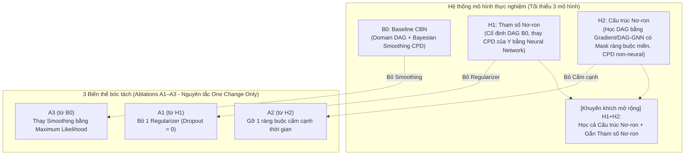

# TỔNG QUAN YÊU CẦU MÔN HỌC: MÔ HÌNH ĐỒ THỊ CÓ XÁC SUẤT (IT701100)
> **Học kỳ:** HK1, 2026–2027  
> **Giảng viên hướng dẫn:** TS. Nguyễn Chí Thiện (Nguyen Chi Thien, Ph.D.)  
> **Chủ đề nghiên cứu:** Causal Bayesian Networks (Mạng Bayes Nhân quả) kết hợp Học Sâu (Deep Learning)  
> **Tài liệu gốc:** `docs/pdf/HK1_2026_IT701100_Mô hình đồ thị có xác suất_N01.pdf` (62 slides)  
> **Link Google Drive tài liệu:** [HK1_2026_IT701100_Mô hình đồ thị có xác suất_N01.pdf](https://drive.google.com/file/d/11vuIrPn783XorbLwZcXEGU3GWCNUEVdx/view?usp=sharing)

---

## 1. Quy chế tổ chức, Nộp bài & Đánh giá (Course Administration)

### 1.1. Quy định nhóm & Phân chia điểm số
* **Quy mô nhóm:** Nhóm từ **1 đến 2 học viên** (Group of 1–2 students).
* **Quy tắc phân bổ điểm nhóm 2 người:**
  $$\text{Score}(\text{First Author}) - \text{Score}(\text{Co-Author}) = 1.0 \text{ điểm}$$
  *(Nhóm phải tự thỏa thuận và phân định rõ ràng mức độ đóng góp: First Author chịu trách nhiệm chính về kiến trúc/thực nghiệm cốt lõi; Co-Author chịu trách nhiệm phối hợp triển khai).*
* **Quy định nộp bài:** **TẤT CẢ các thành viên trong nhóm** đều phải nộp file mã nguồn (`.ipynb`) của nhóm lên hệ thống (All group members submit the group's work).

### 1.2. Hai đợt đánh giá trọng tâm
| Đợt đánh giá | Thời hạn & Hình thức | Sản phẩm nộp bắt buộc | Tiêu chí đánh giá & Cảnh báo |
| :--- | :--- | :--- | :--- |
| **GIỮA KỲ (Midterm)** | • Thời gian hoàn thành: **2 tuần**. • Báo cáo: **Trực tuyến (Online)** trên lớp. | 1. Slide thuyết trình (`.pdf`/`.pptx`). 2. File Notebook (`.ipynb`) đã chạy lưu sẵn toàn bộ output (Mỗi thành viên tự nộp). | • Đánh giá: **Accept / Reject** đề tài. • Điểm số: **10 điểm** (4đ Foundations + 6đ Application). • Kịch bản demo 6 bước trực tiếp trên Colab. |
| **CUỐI KỲ (Final)** | • Thời hạn: Theo lịch thi cuối kỳ của trường. • Nộp bài trực tuyến. | 1. Báo cáo hoàn chỉnh: **Bắt buộc file PDF biên dịch từ LaTeX** (kèm mã nguồn LaTeX). 2. Mã nguồn hoàn chỉnh tái lập (reproducible codebase). 3. Toàn bộ artifacts (split indices, checkpoints, kết quả dạng bảng). | • Điểm số: **10 điểm** (chia cho 9 mục theo chuẩn bài báo quốc tế). • **Kiểm tra chống gian lận & AI qua Turnitin:** Báo cáo sẽ được đẩy lên hệ thống **Turnitin Check AI / Plagiarism**, yêu cầu tự viết trung thực, có trích dẫn chuẩn mực. |

---

## 2. Các nguyên lý khoa học cốt lõi (Giảng viên nhấn mạnh)

1. **Hướng tới giải quyết bài toán thực tế, không biểu diễn công cụ:**
   * Nghiên cứu phải bắt nguồn từ nhu cầu thực tiễn: "Cần can thiệp chính sách / hành động gì để thay đổi kết quả?".
   * Nếu dữ liệu bảng hiện tại quá nghèo nàn hoặc thiếu biến số: **Chủ động thu thập thêm dữ liệu (crawl more data)** hoặc **kỹ nghệ thêm đặc trưng (add meaningful features)** để bài toán có giá trị thực tiễn cao hơn.
2. **Phân định dứt khoát giữa Quan sát (Observation) và Can thiệp (Intervention):**
   * *Sai lầm phổ biến:* Đưa ra chính sách/khuyến nghị can thiệp nhưng lại dựa vào công thức tính xác suất quan sát $P(Y \mid T=t)$.
   * *Nguyên tắc bắt buộc:* Mọi khuyến nghị hành động phải được đo lường trực tiếp thông qua toán tử can thiệp $P(Y \mid \text{do}(T=t))$.
3. **Tính toán bất định — Kỳ vọng và Rủi ro:**
   * Không chỉ báo cáo một con số ATE điểm duy nhất. Bắt buộc phải tính toán **Kỳ vọng (Expectation)**, **Rủi ro (Risk / Risk Difference)** và **Độ bất định (Uncertainty / 95% Confidence Intervals / Standard Deviation)**.
4. **Tầng thiết kế thực nghiệm: Lặp nhiều lần (Multiple Seeds):**
   * Chạy 1 lần thực nghiệm là **hoàn toàn không đủ** và thiếu cơ sở khoa học (dẫn đến cái nhìn phiến diện, ngộ nhận ngẫu nhiên thành bản chất).
   * Bắt buộc phải thực hiện trên **ít nhất 5 hạt giống ngẫu nhiên (seeds $\ge 5$)** hoặc phân chia ghép cặp cố định để đo độ ổn định thuật toán.
5. **Cơ chế học đồ thị nơ-ron (Gradient-based DAG Learning):**
   * Trong H2: Tìm node, tính đạo hàm ma trận trọng số $W$ theo hàm mất mát liên tục có phạt phi chu trình ($h(W) = 0$), từ gradient vẽ ra cấu trúc DAG.
   * **ChatGPT là KHÔNG ĐỦ:** Tuyệt đối không dùng ChatGPT để gợi ý đồ thị rồi xem đó là học cấu trúc nơ-ron. Bắt buộc phải dùng thuật toán tối ưu vi phân (DAG-GNN / NOTEARS).
6. **Công cụ kiểm định tự động (Verification & Refutation Tools):**
   * Bắt buộc tích hợp công cụ kiểm định chuẩn mực: `pgmpy` kiểm tra tính hợp lệ của phân phối (`check_model`), `DoWhy` nhận diện và thực hiện các bài kiểm tra bác bỏ (`placebo_treatment_refuter`, `data_subset_refuter`), và `DoWhy GCM` mô phỏng can thiệp.

---

## 3. Bản đồ kiến trúc thực nghiệm (Tối thiểu 3 mô hình + Mở rộng)

Quy định chuẩn: **Tối thiểu phải triển khai 3 mô hình cơ sở (B0, H1, H2)** và được khuyến khích phát triển thêm các mô hình mở rộng kết hợp:

* **B0 (Baseline CBN):** Domain DAG + CPD phi nơ-ron (Bayesian smoothing với BDeu prior).
* **H1 (Neural Parameters):** Cố định DAG B0, dùng mạng nơ-ron sâu học phân phối $P(Y \mid \text{Parents}(Y))$.
* **H2 (Neural Structure):** Tối ưu hóa gradient liên tục để học DAG kèm ma trận mặt nạ cạnh cấm theo miền và thời gian.
* **H1+H2 (Mở rộng tùy chọn):** Tích hợp cả học cấu trúc nơ-ron H2 và học tham số nơ-ron H1.
* **Ablations A1–A3:** Đổi duy nhất 1 thành phần từ mô hình cha để đo lường độc lập ảnh hưởng của từng yếu tố kỹ thuật.

---

## 4. Hệ thống tài liệu Requirements chi tiết

| Thư mục / File | Mô tả nội dung |
| :--- | :--- |
| 📁 [`docs/requirements/midterm/`](./midterm/README.md) | **Yêu cầu chi tiết Midterm:** Quy chế nhóm, thời gian 2 tuần, tiêu chí Accept/Reject, kịch bản 6 bước demo online trên Google Colab. |
| 📋 [`docs/requirements/midterm/checklist.md`](./midterm/checklist.md) | **Bảng Checklist Midterm:** Rà soát từng tiêu chí trước khi báo cáo trực tuyến. |
| 📁 [`docs/requirements/final/`](./final/README.md) | **Yêu cầu chi tiết Final:** Quy chuẩn viết báo cáo LaTeX PDF, cảnh báo Turnitin AI Check, 3 bảng kết quả thực nghiệm chuẩn (Bảng A, B, C). |
| 📝 [`docs/requirements/final/report_template_structure.md`](./final/report_template_structure.md) | **Khung mẫu bài báo cáo Final (LaTeX Structure):** Sườn dàn ý chi tiết từ Abstract đến Q&A theo chuẩn mực quốc tế. |
