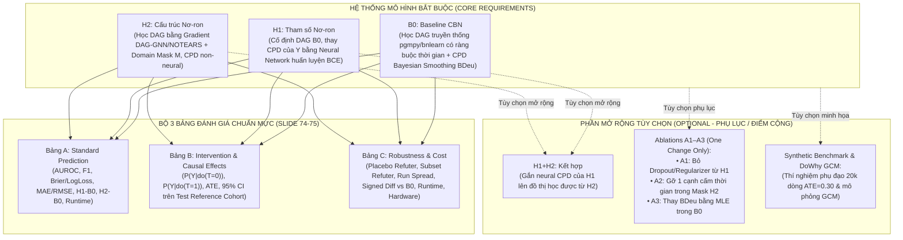

# TỔNG QUAN YÊU CẦU MÔN HỌC: MÔ HÌNH ĐỒ THỊ CÓ XÁC SUẤT (IT701100)
> **Học kỳ:** HK1, 2026–2027  
> **Giảng viên hướng dẫn:** TS. Nguyễn Chí Thiện (Nguyen Chi Thien, Ph.D.)  
> **Chủ đề nghiên cứu:** Causal Bayesian Networks (Mạng Bayes Nhân quả) kết hợp Học Sâu (Deep Learning)  
> **Tài liệu gốc chuẩn hóa:** `docs/pdf/HK1_2026_IT701100_Mô hình đồ thị có xác suất_N01.pdf` (**80 slides hoàn chỉnh**, cập nhật Implementation Guide & Rubric chi tiết)  
> **Link Google Drive tài liệu:** [HK1_2026_IT701100_Mô hình đồ thị có xác suất_N01.pdf](https://drive.google.com/file/d/11vuIrPn783XorbLwZcXEGU3GWCNUEVdx/view?usp=sharing)  
> **Link Gemini NotebookLM tham khảo:** [Gemini Notebook (IT701100)](https://notebook.google.com/notebook/33dd2d2a-8013-4591-a1c2-bc6c0d0fd32a)

---

## 1. Quy chế tổ chức, Nộp bài & Đánh giá (Course Administration)

### 1.1. Quy định nhóm & Phân chia điểm số
* **Quy mô nhóm:** Nhóm từ **1 đến 2 học viên** (Group of 1–2 students).
* **Quy tắc phân bổ điểm nhóm 2 người:**
  $$\text{Score}(\text{First Author}) - \text{Score}(\text{Co-Author}) = 1.0 \text{ điểm}$$
  *(Nhóm phải tự thỏa thuận và phân định rõ ràng mức độ đóng góp: First Author chịu trách nhiệm chính về kiến trúc/thực nghiệm cốt lõi; Co-Author chịu trách nhiệm phối hợp triển khai, phân tích dữ liệu và kiểm thử).*
* **Quy định nộp bài:** **TẤT CẢ các thành viên trong nhóm** đều phải nộp file mã nguồn (`.ipynb`) của nhóm lên hệ thống (All group members submit the group's work).

### 1.2. Hai đợt đánh giá trọng tâm
| Đợt đánh giá | Thời hạn & Hình thức | Sản phẩm nộp bắt buộc | Tiêu chí đánh giá & Minh chứng cốt lõi |
| :--- | :--- | :--- | :--- |
| **GIỮA KỲ (Midterm)** | • Thời gian hoàn thành: **2 tuần**. • Báo cáo: **Trực tuyến (Online)** trên lớp. | 1. Slide thuyết trình (`.pdf`/`.pptx`). 2. File Notebook (`.ipynb`) đã chạy lưu sẵn toàn bộ output (Mỗi thành viên tự nộp). | • Đánh giá: **Accept / Reject** đề tài. • Điểm số: **10 điểm** (4đ Foundations + 6đ Application). • **Kịch bản demo Colab 6 bước tuần tự** (Slide 77): đối chiếu $P(Y \mid T)$ vs $P(Y \mid \text{do}(T))$, hiển thị $q_m(t, C_i)$, chuẩn hóa quần thể tham chiếu $C_{\text{test}}$, kiểm định DoWhy và phân tích ca thất bại/kết quả rỗng. |
| **CUỐI KỲ (Final)** | • Thời hạn: Theo lịch thi cuối kỳ của trường. • Nộp bài trực tuyến. | 1. Báo cáo hoàn chỉnh: File **PDF biên dịch từ LaTeX** (hoặc `.docx` học thuật theo Slide 49) kèm mã nguồn `.tex` & ảnh/bảng. 2. Mã nguồn hoàn chỉnh tái lập (reproducible codebase). 3. Toàn bộ artifacts (split indices, checkpoints, kết quả dạng bảng máy đọc được `.json`/`.csv`). | • Điểm số: **10 điểm** (chia cho 9 mục theo chuẩn bài báo quốc tế, Slide 50 & 78). • **Kiểm tra chống gian lận & AI qua Turnitin:** Báo cáo sẽ được kiểm tra qua hệ thống **Turnitin Check AI / Plagiarism**, yêu cầu tự viết trung thực, có trích dẫn chuẩn mực và bản cam kết minh bạch sử dụng AI (AI-use Statement). |

---

## 2. Các nguyên lý khoa học cốt lõi (Cập nhật chuẩn hóa từ Slide 51–80)

1. **Hướng tới giải quyết bài toán thực tế trên dữ liệu bảng (Problem-Driven on UCI Tabular Data):**
   * Nghiên cứu phải bắt nguồn từ nhu cầu thực tiễn: "Cần can thiệp chính sách / hành động gì để thay đổi kết quả?".
   * Đề tài bắt buộc triển khai trên **một bộ dữ liệu bảng UCI** có tài liệu biến số, thời điểm đo lường và định nghĩa can thiệp rõ ràng (Slide 51, 53, 55).
   * Nếu dữ liệu bảng hiện tại quá nghèo nàn hoặc thiếu biến số: **Chủ động thu thập thêm dữ liệu (crawl more data)** hoặc **kỹ nghệ thêm đặc trưng có ý nghĩa (feature engineering)**.
2. **Phân định dứt khoát giữa Quan sát (Observation) và Can thiệp (Intervention):**
   * *Sai lầm phổ biến:* Đưa ra chính sách/khuyến nghị can thiệp nhưng lại dựa vào công thức tính xác suất quan sát $P(Y \mid T=t)$.
   * *Nguyên tắc bắt buộc:* Mọi khuyến nghị hành động phải được đo lường trực tiếp thông qua toán tử can thiệp $P(Y \mid \text{do}(T=t))$ qua phẫu thuật đồ thị (graph surgery / Backdoor adjustment).
3. **Chuẩn hóa quần thể tham chiếu trên tập Test (Common Test Reference Cohort Standardization):**
   * Nhãn kết quả $Y_{\text{test}}$ chỉ dùng để chấm điểm dự báo (prediction).
   * **Tuyệt đối không dùng nhãn $Y_{\text{test}}$ để tính hiệu ứng can thiệp!** Hiệu ứng can thiệp được chuẩn hóa bằng cách lấy trung bình nguy cơ điều kiện $q_m(t, C_i) = P_m(Y=1 \mid T=t, C_i)$ trên cùng một tập hiệp biến nền tiền can thiệp $C_{\text{test}}$ của tập kiểm thử:
     $$\text{risk}_m(t) = \frac{1}{n_{\text{test}}} \sum_{i \in \text{TEST}} q_m(t, C_i), \quad \text{ATE}_m = \text{risk}_m(1) - \text{risk}_m(0)$$
4. **Tách biệt đánh giá Dự báo (Prediction) và Đánh giá Can thiệp (Intervention):**
   * Một mô hình nơ-ron có loss dự báo thấp hay AUROC cao **không đồng nghĩa** với việc nó ước lượng đúng hiệu ứng nhân quả.
   * Khoảng tin cậy hẹp hay hiệu ứng ổn định đơn thuần không chứng minh được tính chân lý nhân quả. Cần biện giải dựa trên các giả định nhận diện và kiểm thử bác bỏ (DoWhy refutations).
5. **Thiết kế thực nghiệm: Ghép cặp trên ít nhất 5 lần chạy (At Least 5 Paired Runs):**
   * Chạy 1 lần thực nghiệm là **hoàn toàn không đủ** và thiếu cơ sở khoa học.
   * Bắt buộc phải thực hiện trên **ít nhất 5 lần chạy ghép cặp (paired runs $\ge 5$)** dùng chung phân chia dữ liệu Train/Val/Test để báo cáo độ lệch chuẩn, khoảng tin cậy 95% và chênh lệch ghép cặp có dấu ($H_1 - B_0$, $H_2 - B_0$).
6. **Học đồ thị nơ-ron có ràng buộc miền (Gradient-based DAG with Domain Mask):**
   * Trong H2: Tối ưu hóa liên tục (DAG-GNN / NOTEARS) trên ma trận kề $W$ với hàm phạt chu trình $h(W) = 0$ và ma trận mặt nạ cạnh cấm $M$: $W_{\text{eff}} = M \odot W$ (Slide 63).
   * **ChatGPT là KHÔNG ĐỦ:** Hỏi ChatGPT gợi ý đồ thị không được coi là thuật toán học cấu trúc. Phải học từ gradient và dữ liệu Train.
7. **Công cụ kiểm định tự động & Kiểm chứng tính vững (Verification & Refutation Tools):**
   * Tích hợp chuẩn mực: `pgmpy` kiểm tra phân phối (`check_model`), `DoWhy` nhận diện và thực hiện **ít nhất 2 bài kiểm tra bác bỏ bắt buộc**:
     1. `placebo_treatment_refuter` (hoán vị nhãn can thiệp $T$, hiệu ứng kỳ vọng về gần 0).
     2. `data_subset_refuter` (ước lượng lại trên tập con 80% để kiểm tra độ nhạy mẫu).
8. **Quy tắc xử lý và báo cáo các ca thất bại (Common Failures & Required Responses - Slide 79):**
   * Mất cân bằng bao phủ/ô xác suất rỗng: Báo cáo tỷ lệ nhóm bị ảnh hưởng, không tự ý thu hẹp mục tiêu nếu không giải trình.
   * Đồ thị H2 học ra chu trình hoặc vi phạm trật tự thời gian: Áp dụng quy tắc sửa chu trình đã khai báo trước hoặc ghi nhận trung thực lỗi học cấu trúc; không ngụy tạo kết quả thành hiệu ứng nhân quả hợp lệ.
   * Lỗi xác suất cực đoan / xác suất 0 trong MLE: Khai báo quy ước xử lý số học tách bạch với kỹ thuật làm mịn xác suất.

---

## 3. Bản đồ kiến trúc thực nghiệm (Core Models vs. Optional Extensions)

Theo quy định chuẩn hóa tại **Slide 51, 53 & 75**, hệ thống thực nghiệm được phân định rõ ràng giữa **Yêu cầu cốt lõi (Core Requirements)** và **Phần mở rộng tùy chọn (Optional Extensions)**:

> [!IMPORTANT]
> **Lưu ý cốt lõi từ Giảng viên (Slide 51, 53, 75):**
> * Đề tài **chỉ bắt buộc thực hiện trên 01 bộ dữ liệu bảng UCI** (ví dụ: UCI ID 320 Student Performance hoặc UCI ID 697 Student Dropout).
> * **Bài toán mô phỏng phụ đạo (Synthetic Benchmark ATE=0.30) và các biến thể bóc tách A1–A3 KHÔNG PHẢI là yêu cầu bắt buộc của Rubric** (không có mục điểm riêng trong Rubric 10 điểm). Chúng đóng vai trò là ví dụ minh họa giảng dạy trên lớp hoặc phần mở rộng tùy chọn đưa vào Phụ lục (Appendix).
> * **Bảng A, B, C chính thức theo Slide 74–75:**
>   * **Bảng A:** So sánh chỉ số dự báo ngoài mẫu (Prediction Comparison) của B0, H1, H2.
>   * **Bảng B:** So sánh hiệu ứng can thiệp chuẩn hóa trên tập Test (Interventions & ATE) của B0, H1, H2.
>   * **Bảng C:** Đánh giá tính vững bác bỏ (Placebo & Subset refuters), độ ổn định và chi phí tính toán (Robustness & Cost).

---

## 4. Bảng đối chiếu cấu trúc Slide cập nhật (Từ 62 lên 80 Slides)

| Khoảng Slide | Tiêu đề phân đoạn | Nội dung trọng tâm |
| :---: | :--- | :--- |
| **Slide 1–17** | **Foundations & Tutoring Example** | Khái niệm PGM, CBN, đồ thị DAG, phân rã điều kiện, bài toán minh họa phụ đạo sinh viên, phân biệt quan sát vs can thiệp, tiêu chuẩn Backdoor, hiệu ứng lý thuyết chân lý ATE = 0.30. |
| **Slide 18–24** | **Classroom Code & Libraries** | Mã nguồn minh họa lớp học: khớp mô hình `pgmpy`, truy vấn `do`, ước lượng `DoWhy`, mô phỏng `DoWhy GCM`, kiểm định bác bỏ refutation. |
| **Slide 25–27** | **UCI Tabular Data** | Yêu cầu nguồn dữ liệu UCI, ví dụ Student Performance (ID 320), nạp dữ liệu tái lập. |
| **Slide 28–38** | **Comparison Protocol & Models** | Giao thức chia Train/Val/Test, định nghĩa B0, H1, H2, khái niệm bóc tách A1–A3, ghép cặp ít nhất 5 runs, các bảng kết quả khái quát. |
| **Slide 39–44** | **Presentation Scope & Rubrics** | Phạm vi thuyết trình Midterm, gợi ý câu hỏi UCI, vai trò thư viện, **Rubric Thuyết trình Midterm (10 điểm: 4đ Foundations + 6đ Application)**, yêu cầu Notebook Colab (lưu ý: Synthetic & A1–A3 là tùy chọn). |
| **Slide 45–50** | **Report Rubric (Final 10 points)** | **Rubric Báo cáo Final (10 điểm, chia 9 mục 2.1–2.9)**, ánh xạ chuẩn đầu ra CLO1–CLO5. |
| **Slide 51–52** | **Checklist & References** | Checklist tính tái lập và diễn giải kết quả; danh mục tài liệu tham khảo chính thức (DoWhy, pgmpy, UCI). |
| **Slide 53–56** | **Implementation Guide: Setup & Data Audit** | **[MỚI]** Bản đồ thực nghiệm bắt buộc; đặc tả câu hỏi can thiệp trước khi lập mô hình (deliverables: câu hỏi, từ điển biến, công thức mục tiêu, bảng giả định); kiểm toán dữ liệu UCI (URL, checksum, dòng lọc, rò rỉ nhãn, overlap); tiền xử lý chung và chia tập (70/15/15, chuẩn hóa hiệp biến nền $C_{\text{test}}$). |
| **Slide 57–63** | **Implementation Guide: Models B0, H1, H2** | **[MỚI]** Chi tiết quy trình học DAG B0 (pgmpy HillClimb/PC hoặc bnlearn); B0 workflow 6 bước; H1 nơ-ron CPD và công thức can thiệp cụ thể $q_m(t, Z_i)$; H2 học đồ thị liên tục, ma trận mặt nạ $W_{\text{eff}} = M \odot W$, ràng buộc chu trình. |
| **Slide 64–67** | **Optional Extensions: A1, A2, A3** | **[MỚI]** Quy định chi tiết các thí nghiệm bóc tách tùy chọn A1 (bỏ dropout), A2 (gỡ 1 cạnh cấm), A3 (MLE vs Bayesian smoothing BDeu trong pgmpy). |
| **Slide 68–73** | **Implementation Guide: Evaluation & DoWhy** | **[MỚI]** Giao thức 5 paired runs, độ bất định, tiêu chuẩn đánh giá cốt lõi; chi tiết thực thi DoWhy Placebo và Data Subset; mở rộng tùy chọn mô phỏng GCM và phản thực tế (counterfactuals). |
| **Slide 74–75** | **Implementation Guide: Tables A, B, C** | **[MỚI]** Định nghĩa chi tiết các cột và hàng của **Bảng A (Prediction), Bảng B (Intervention) và Bảng C (Robustness & Cost)**. |
| **Slide 76–80** | **Implementation Guide: Submission & Defense** | **[MỚI]** Cấu trúc Notebook Colab một khối config duy nhất và artifacts tái lập; **Kịch bản Demo trực tiếp 6 bước (Slide 77)**; Hướng dẫn minh chứng cho 9 phần Báo cáo (Slide 78); Bảng xử lý 6 trường hợp thất bại thường gặp (Slide 79); Tài liệu và mã nguồn tham khảo mở rộng (Slide 80). |

---

## 5. Danh mục tài liệu Requirements chi tiết trong Workspace

| Đường dẫn tài liệu | Vai trò & Nội dung chi tiết |
| :--- | :--- |
| 📁 [`docs/requirements/midterm/README.md`](./midterm/README.md) | **Cẩm nang toàn diện Midterm:** Quy chế nhóm, tiêu chí Accept/Reject, Rubric 10 điểm chuẩn hóa theo Slide 42–43, kịch bản demo Colab 6 bước tuần tự theo Slide 77. |
| 📋 [`docs/requirements/midterm/checklist.md`](./midterm/checklist.md) | **Bảng Checklist kiểm soát Midterm:** Danh mục rà soát từng tiêu chí trước khi bước vào buổi bảo vệ trực tuyến. |
| 📁 [`docs/requirements/final/README.md`](./final/README.md) | **Cẩm nang toàn diện Final:** Quy chuẩn báo cáo LaTeX/PDF (Slide 49), cảnh báo kiểm duyệt Turnitin Check AI, định nghĩa chi tiết Bảng A, B, C theo Slide 74–75, hướng dẫn xử lý thất bại theo Slide 79. |
| 📝 [`docs/requirements/final/report_template_structure.md`](./final/report_template_structure.md) | **Khung mẫu bài báo cáo LaTeX (Template Outline):** Dàn ý chi tiết 9 mục (2.1–2.9) tương ứng từng tiêu chí điểm của Rubric Final (Slide 50 & 78). |
