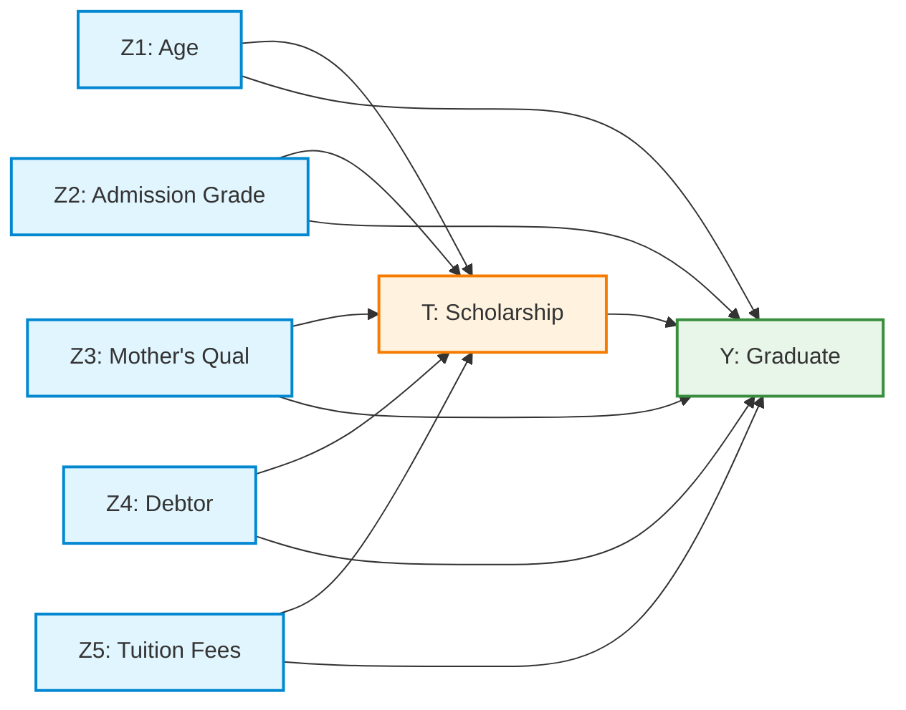

# BÁO CÁO NGHIÊN CỨU GIỮA KỲ (MIDTERM RESEARCH REPORT)
## ĐÁNH GIÁ CÁC MÔ HÌNH NHÂN QUẢ HYBRID (CBN & DEEP LEARNING) TRÊN DỮ LIỆU GIÁO DỤC BẢNG UCI ID 697
> **Học phần:** Mô hình đồ thị có xác suất (IT701100) — Học kỳ 1, Năm học 2026–2027  
> **Giảng viên hướng dẫn:** TS. Nguyễn Chí Thiện (Nguyen Chi Thien, Ph.D.)  
> **Nhóm học viên:** Nhóm nghiên cứu Causal ML (Chương trình Thạc sĩ CNTT)  
> **Thời gian làm bài:** 2 tuần | **Hình thức:** Báo cáo trực tuyến (Online Presentation & Live Notebook Demo)  
> **Thang điểm Rubric:** 10.0 điểm (4.0đ Foundations + 6.0đ Application)  
> **Tài liệu quy chiếu:** Slide 39–44, 51, 53–75, 76–77, 79, 80 (`HK1_2026_IT701100_Mô hình đồ thị có xác suất_N01.pdf` - 80 slides).  
> **Các quyết định kiến trúc đi kèm:** [ADR-001](file:///e:/01_Research_Study_Master/04_Probabilistic_GrModel/report/decisions/ADR_001_dataset_selection.md) | [ADR-002](file:///e:/01_Research_Study_Master/04_Probabilistic_GrModel/report/decisions/ADR_002_causal_formulation.md) | [ADR-003](file:///e:/01_Research_Study_Master/04_Probabilistic_GrModel/report/decisions/ADR_003_causal_modeling_and_ablation_architecture.md) | [ADR-004](file:///e:/01_Research_Study_Master/04_Probabilistic_GrModel/report/decisions/ADR_004_alternative_outcomes_and_causal_perspectives.md)

---

## TÓM TẮT BÁO CÁO (EXECUTIVE SUMMARY)

Ước lượng hiệu ứng can thiệp nhân quả từ dữ liệu bảng quan sát đóng vai trò nền tảng trong việc hoạch định chính sách giáo dục đại học. Mặc dù các mạng Bayes nhân quả truyền thống (Causal Bayesian Networks - CBN) cung cấp khung toán học định danh chặt chẽ và khả năng giải thích tường minh thông qua giải tích can thiệp do-calculus của Judea Pearl, chúng dựa vào các bảng phân phối xác suất rời rạc (CPD) vốn gặp nhiều thách thức trước các tương tác phi tuyến phức tạp và hiện tượng ô dữ liệu thưa (*sparse data*). 

Trong công trình nghiên cứu này, chúng tôi xây dựng một chuẩn đối sánh có kiểm soát giữa mô hình CBN truyền thống (**B0**) và hai mở rộng học sâu, cả ba dùng **cùng biến, cùng hàng TRAIN/VALIDATION/TEST và cùng ràng buộc thời gian** (cấm $Y \to \{T, Z\}$, cấm $T \to Z$, bắt buộc $T \to Y$):
1. **B0:** học DAG trên TRAIN bằng `pgmpy.HillClimbSearch` (hàm điểm BIC/BDeu/K2 chọn theo log-likelihood VALIDATION) + CPD rời rạc BDeu ($ESS = 5$).
2. **H1 (Neural CPD):** giữ nguyên DAG B0 của từng run, thay CPD của $Y$ bằng MLP PyTorch chỉ nhận $\text{Pa}(Y)$, dừng sớm trên VALIDATION.
3. **H2 (Neural discovery):** NOTEARS-MLP phi tuyến (Zheng et al., 2020) với cùng mặt nạ thời gian $M$; kiểm tra hội tụ $h(W) < 10^{-6}$; $\lambda_1$ và ngưỡng cạnh chọn trên VALIDATION; CPD BDeu như B0.

Thực nghiệm trên UCI ID 697 qua **5 lượt chạy ghép cặp** (70/15/15). Dự báo được chấm trên $Y_{\text{test}}$; rủi ro can thiệp và ATE được chuẩn hóa trên hiệp biến $C_{\text{test}}$, **không dùng $Y_{\text{test}}$**.

**Kết quả chính.** ATE của học bổng ổn định giữa ba mô hình: $B_0 = +0.2418 \pm 0.0046$, $H_1 = +0.2374 \pm 0.0114$, $H_2 = +0.2358 \pm 0.0067$ (chênh lệch thô $+0.3454$). Về dự báo, hiệu ghép cặp $\Delta\text{AUROC}_{H_1 - B_0} = +0.0016 \pm 0.0025$ và $\Delta_{H_2 - B_0} = +0.0038 \pm 0.0038$ nằm trong độ tản giữa các run ⇒ **không có bằng chứng** phần nơ-ron cải thiện dự báo (null finding). Phần mở rộng (kết cục đa chiều, trung gian $21.5\%$, CATE theo nhóm, độ nhạy $RV_{q=1} = 20.97\%$) được báo cáo như phân tích phụ.

---

## PHẦN 1: CƠ SỞ LÝ THUYẾT VÀ BIỂU DIỄN NHÂN QUẢ (FOUNDATIONS - 4.0 ĐIỂM)

### 1.1. Phát biểu Bài toán Can thiệp Chính sách & Không gian Biến số (Tiêu chí 1 & 4 - 2.0 điểm)
* **Bối cảnh thực tiễn:** Trong quản trị đại học, hiện tượng sinh viên bỏ học (*Dropout*) gây tổn thất lớn về nguồn lực xã hội. Chính sách cấp học bổng / hỗ trợ tài chính là công cụ can thiệp phổ biến, nhưng hiệu quả thực chất của nó thường bị che mờ bởi các yếu tố gây nhiễu nền (*Confounders*) như điểm tuyển sinh đầu vào cao hơn hoặc hoàn cảnh kinh tế gia đình thuận lợi hơn.
* **Câu hỏi nhân quả mục tiêu:**
  $$\text{Dưới các giả định nhận diện Backdoor, việc can thiệp áp đặt chính sách cấp học bổng } do(T=1) \text{ làm thay đổi}$$
  $$\text{xác suất tốt nghiệp } Y=1 \text{ như thế nào so với tình huống không can thiệp } do(T=0) \text{ trên cùng một quần thể sinh viên?}$$

#### Bảng 1: Từ điển Biến số trong Primary Domain DAG (7 nút)
Các biến số được tinh lọc nghiêm ngặt từ tập dữ liệu UCI ID 697 theo trật tự thời gian logic:

| Tên biến trong UCI 697 | Ký hiệu | Ý nghĩa nội dung | Miền giá trị mã hóa | Thời điểm đo lường | Vai trò Causal |
| :--- | :---: | :--- | :--- | :--- | :--- |
| `Scholarship holder` | **$T$** | Sinh viên được cấp học bổng / tài trợ | $0 = \text{Không}, 1 = \text{Có}$ | Lúc nhập học ($t_1$) | **Biến can thiệp (Treatment)** |
| `Target` | **$Y$** | Kết quả học tập cuối khóa | $1 = \text{Graduate}, 0 = \text{Dropout}$ | Kết thúc khóa ($t_2$) | **Biến kết quả (Outcome)** |
| `Admission grade` | **$Z_1$** | Điểm xét tuyển đầu vào | 3 nhóm: $<120$, $[120, 140)$, $\ge 140$ | Trước nhập học ($t_0$) | **Confounder** |
| `Debtor` | **$Z_2$** | Nợ học phí lúc nhập học | $0 / 1$ | Nhập học ($t_0$) | **Confounder** |
| `Tuition fees up to date` | **$Z_3$** | Đóng học phí đúng hạn | $0 / 1$ | **Mơ hồ** — có thể cập nhật sau nhập học | **Confounder (giả định)**; nguy cơ là hậu quả của bỏ học |
| `Mother's qualification` | **$Z_4$** | Học vấn của mẹ | $1$ nếu mã $\ge 13$ (đại học trở lên) | Trước nhập học ($t_0$) | **Confounder** |
| `Age at enrollment` | **$Z_5$** | Tuổi khi nhập học | $1$ nếu $> 20$ | Nhập học ($t_0$) | **Confounder** |

> [!IMPORTANT]
> **Quy tắc Kiểm toán Chống Rò rỉ (No-Leakage / Collider & Mediator Avoidance):**  
> Toàn bộ các biến kết quả học kỳ 1 và 2 (như `Curricular units 1st/2nd sem grade`, `approved`) diễn ra **SAU** khi học bổng đã phát huy tác dụng. Nếu đưa chúng vào tập điều chỉnh ban đầu sẽ gây ra thiên lệch rò rỉ biến trung gian (*Mediator Over-controlling Bias*). Do đó, chúng bị loại bỏ tuyệt đối khỏi tập $\mathbf{Z}$ của mô hình cốt lõi.

---

### 1.2. Domain DAG tham chiếu & Phân rã Xác suất Đồng thời
Domain DAG dưới đây (7 nút, 11 cạnh) là **giả thuyết tham chiếu** dùng cho DoWhy ở mục 7 của notebook. **B0 không dùng trực tiếp DAG này** mà học DAG riêng trên TRAIN (mục 1.4); DAG học được có $\text{Pa}(Y) = \{T, Z_2, Z_3, Z_5\}$, thưa hơn Domain DAG.
* 5 cạnh từ biến nền sang can thiệp: $Z_i \to T, \forall i \in \{1, \dots, 5\}$.
* 5 cạnh từ biến nền sang kết quả: $Z_i \to Y, \forall i \in \{1, \dots, 5\}$.
* 1 cạnh can thiệp trực tiếp: $T \to Y$.



#### Công thức Phân rã Xác suất Đồng thời (Chain Rule / Factorization):
$$P(Z_1, Z_2, Z_3, Z_4, Z_5, T, Y) = \left[ \prod_{i=1}^5 P(Z_i) \right] \cdot P(T \mid Z_1, Z_2, Z_3, Z_4, Z_5) \cdot P(Y \mid T, Z_1, Z_2, Z_3, Z_4, Z_5)$$

#### Ba Giả định Nhận diện Nhân quả Bắt buộc:
1. **Không có yếu tố gây nhiễu tiềm ẩn (No Unmeasured Confounding / Ignorability):** $Y(t) \perp T \mid \mathbf{Z}$. Toàn bộ các đường đi cửa sau nối từ $T$ đến $Y$ đều bị chặn bởi tập điều chỉnh $\mathbf{Z} = \{Z_1, Z_2, Z_3, Z_4, Z_5\}$.
2. **Tính nhất quán (Consistency):** Nếu $T_i = t$ thì biến cố tiềm năng quan sát được bằng chính giá trị can thiệp: $Y_i = Y_i(t)$.
3. **Tính bao phủ / Tính dương (Positivity / Overlap):** $0 < P(T=1 \mid \mathbf{Z}=\mathbf{z}) < 1, \forall \mathbf{z} \in \text{supp}(\mathbf{Z})$. Không có phân tầng nào bị triệt tiêu cơ hội nhận học bổng.

---

### 1.3. Phân biệt Bản chất: Quan sát $P(Y \mid T)$ vs Can thiệp $P(Y \mid do(T))$ (Tiêu chí 3 - 1.0 điểm)

Sự sai lệch giữa nhận thức thống kê thông thường và suy luận nhân quả được định nghĩa toán học:

```
+---------------------------------------------------------------------------------------------------+
| XÁC SUẤT ĐIỀU KIỆN QUAN SÁT P(Y | T = t)                                                          |
| Chứa đựng cả dòng thông tin nhân quả (T -> Y) và dòng thông tin sai lệch cửa sau (T <- Z -> Y):   |
| P(Y=1 | T=t) = ∑_z P(Y=1 | T=t, Z=z) * P(Z=z | T=t)                                              |
| Phụ thuộc vào phân phối thiên lệch của Z trong nhóm đã nhận học bổng P(Z | T=t).                  |
+---------------------------------------------------------------------------------------------------+
                                            ≠ (KHÔNG BẰNG)
+---------------------------------------------------------------------------------------------------+
| XÁC SUẤT CAN THIỆP PHẪU THUẬT ĐỒ THỊ P(Y | do(T = t))                                             |
| Cắt đứt toàn bộ các cạnh đi vào T (Graph Surgery: T không còn phụ thuộc Z).                       |
| Phân phối của Z được giữ nguyên theo toàn thể quần thể tham chiếu P(Z):                           |
| P(Y=1 | do(T=t)) = ∑_z P(Y=1 | T=t, Z=z) * P(Z=z)                                                 |
+---------------------------------------------------------------------------------------------------+
```

#### Công thức Chuẩn hóa Nguy cơ trên Tập Kiểm thử $C_{\text{test}}$ (Slide 61, 75):
Gọi $C_{\text{test}} = \{\mathbf{z}_i\}_{i \in \text{TEST}}$ là tập hiệp biến nền tham chiếu độc lập gồm $n_{\text{test}} = 545$ sinh viên. Nguy cơ can thiệp chuẩn hóa và hiệu ứng can thiệp trung bình (ATE) của mỗi mô hình $m \in \{B_0, H_1, H_2\}$:
$$q_m(t, \mathbf{z}_i) = P_m(Y=1 \mid T=t, \mathbf{z}_i)$$
$$\text{risk}_m(t) = \frac{1}{n_{\text{test}}} \sum_{i \in \text{TEST}} q_m(t, \mathbf{z}_i), \quad \widehat{\text{ATE}}_m = \text{risk}_m(1) - \text{risk}_m(0)$$

> [!WARNING]
> **Quy định Sống còn của Slide 75:**  
> **Tuyệt đối không sử dụng nhãn thực tế $Y_{\text{test}}$ để tính hiệu ứng can thiệp ATE!** Nhãn $Y_{\text{test}}$ chỉ dùng để chấm điểm dự báo ngoài mẫu (AUROC, Brier). Hiệu ứng can thiệp là kỳ vọng phản thực tế được chuẩn hóa trên không gian hiệp biến $C_{\text{test}}$.

---

### 1.4. Vai trò của Học Tham số và Giới hạn của Học Sâu (Tiêu chí 2 - 2.0 điểm)

1. **Mô hình B0 (học DAG truyền thống + CPD BDeu):**
   * `pgmpy.HillClimbSearch` trên TRAIN với `ExpertKnowledge`: cấm $Y \to \{T, Z\}$, $T \to Z$; bắt buộc $T \to Y$ (giả thuyết cần ước lượng — nếu không có cạnh này thì ATE của mô hình bằng 0 theo định nghĩa).
   * Hàm điểm $\{\text{BIC}, \text{BDeu}, \text{K2}\}$ chọn theo log-likelihood VALIDATION; **K2** thắng ở cả 5 seed. DAG được đóng băng trước khi chạm TEST.
   * CPD BDeu với $ESS = 5$: $\hat P(y \mid \text{pa}) = \dfrac{N(y, \text{pa}) + ESS/(q\,r)}{N(\text{pa}) + ESS/q}$ với $q$ là số cấu hình cha, $r = 2$.
2. **Mô hình H1 (Neural CPD trên DAG B0):**
   * Giữ nguyên DAG B0 của từng run; MLP chỉ nhận $\text{Pa}(Y)$ (4 đầu vào, 769 tham số): Linear–BatchNorm–ReLU–Dropout(0.2)–Linear–ReLU–Linear, BCE, Adam, dừng sớm trên VALIDATION.
   * Liệt kê mọi cấu hình cha → `TabularCPD` chuẩn hóa → thay vào bản sao B0 → `check_model()`. Checkpoint: `artifacts/checkpoints/h1_seed<seed>.pt`.
3. **Mô hình H2 (NOTEARS-MLP phi tuyến):**
   * Mỗi nút $j$ có một MLP $f_j$; $W_{ij} = \lVert \theta^{(1)}_{j,\cdot,i} \rVert_2$. Bài toán: $\min \tfrac12 \text{MSE}(X, f(X)) + \lambda_1 \lVert \theta^{(1)} \rVert_1$ s.t. $h(W) = \text{tr}(e^{W \circ W}) - d = 0$, giải bằng Augmented Lagrangian.
   * Mặt nạ $M$ dùng đúng danh sách cạnh cấm của B0, nhân vào trọng số tầng 1; code assert trọng số bị cấm bằng 0.
   * Hội tụ khi $h < 10^{-6}$ (đạt $\approx 10^{-7}$ ở cả 5 seed); $\lambda_1 = 10^{-4}$ chọn trên VALIDATION seed 42; $\tau \in \{0.1, 0.2\}$ chọn trên VALIDATION từng seed; cạnh $T \to Y$ được học (không bị ép). CPD BDeu như B0; DoWhy identify trên DAG học được.
4. **Phân tích Giới hạn Học thuật của Deep Learning trong Causal Inference:**
   * Mạng nơ-ron sâu có khả năng xấp xỉ vạn năng (Universal Approximation), do đó rất dễ đạt điểm số dự báo cực cao (Loss thấp, AUROC cao) nhờ bắt trúng các mối tương quan giả mạo (*spurious correlation*).
   * **Sự vượt trội về dự báo không đồng nghĩa với tính đúng đắn nhân quả.** Nếu không có các ràng buộc định danh đồ thị (như mặt nạ $M$ và Backdoor adjustment), mạng nơ-ron sẽ ước lượng sai lệch hoàn toàn hiệu ứng can thiệp $ATE$.

---

## PHẦN 2: TRIỂN KHAI THỰC NGHIỆM VÀ KẾT QUẢ ĐỐI SÁNH (APPLICATION - 6.0 ĐIỂM)

### 2.1. Kiểm toán Dữ liệu UCI ID 697 & Đóng băng Splits (Tiêu chí 4 & 5 - 2.0 điểm)
* **Tập dữ liệu:** Predict Students' Dropout and Academic Success (UCI Machine Learning Repository ID: 697).
* **Lưu đồ lọc đối tượng (Eligibility Flow):**
  * Quy mô ban đầu: $4,424$ dòng dữ liệu sinh viên.
  * Lọc bỏ cohort `Enrolled` (đang học, nhãn chưa hoàn tất): $794$ dòng bị loại bỏ.
  * Kích thước tập phân tích nhị phân chính thức: đúng **3,630 dòng** ($2,209$ Graduate: 60.85%; $1,421$ Dropout: 39.15%).
  * Tỷ lệ can thiệp: $969$ sinh viên có học bổng ($26.7\%$) và $2,661$ sinh viên không có học bổng ($73.3\%$).
* **Đóng băng Phân chia Dữ liệu (70/15/15):**
  * Phân chia Stratified theo cả $Y$ và $T$ qua 5 hạt giống cố định: $\text{Seeds} = [42, 43, 44, 45, 46]$.
  * Mỗi run gồm: $2,541$ Train / $544$ Validation / $545$ Test. Toàn bộ chỉ số dòng được xuất thành các file JSON đóng băng (`artifacts/splits/split_seed_{seed}.json`).
  * Tiền xử lý (chuẩn hóa, rời rạc hóa) chỉ `fit` trên tập Train của từng seed, tránh hoàn toàn rò rỉ phân phối sang Val/Test.

### 2.2. Truy vấn can thiệp vector hóa
Truy vấn $q_m(t, C_i)$ dùng numpy advanced indexing trực tiếp trên mảng `cpd_y.values` thay cho `VariableElimination.query()`: ≈ 0.2 ms cho 545 hồ sơ test. Thời gian khớp trung bình mỗi run trên CPU: B0 0.43 s, H1 1.72 s, H2 17.64 s (Table C).

---

### 2.3. BẢNG A: Đối sánh Năng lực Dự báo Ngoài mẫu (Tiêu chí 6 - 1.0 điểm)
*Đo lường trên nhãn thực tế $Y_{\text{test}}$ qua 5 Paired Runs. Ngưỡng phân loại F1 được tối ưu trên tập Validation.*  
*File artifact: [artifacts/tables/Table_A_Prediction.csv](file:///e:/01_Research_Study_Master/04_Probabilistic_GrModel/artifacts/tables/Table_A_Prediction.csv)*

| Model | Đồ thị | AUROC | Macro-F1 | Brier | Log-loss | $\Delta\text{AUROC}_{m - B_0}$ | Fit / run |
| :--- | :--- | :---: | :---: | :---: | :---: | :---: | :---: |
| **B0** | HillClimb-K2 (10–12 cạnh) | $0.7996 \pm 0.0119$ | $0.7351 \pm 0.0077$ | $0.1659 \pm 0.0058$ | $0.4995 \pm 0.0175$ | — | 0.43 s |
| **H1** | DAG B0 + MLP CPD($Y$) | $0.8012 \pm 0.0130$ | $0.7351 \pm 0.0077$ | $0.1656 \pm 0.0062$ | $0.4987 \pm 0.0163$ | $+0.0016 \pm 0.0025$ | 1.72 s |
| **H2** | NOTEARS-MLP (7–9 cạnh) | $0.8034 \pm 0.0155$ | $0.7261 \pm 0.0277$ | $0.1666 \pm 0.0060$ | $0.5086 \pm 0.0117$ | $+0.0038 \pm 0.0038$ | 17.64 s |

#### Nhận xét Bảng A:
1. **Null finding:** hiệu ghép cặp H1−B0 và H2−B0 không vượt độ tản giữa các run; Brier/log-loss gần như không đổi. Không có bằng chứng CPD nơ-ron hay học cấu trúc nơ-ron cải thiện dự báo trên dữ liệu này.
2. Macro-F1 của B0 và H1 trùng nhau vì $\text{Pa}(Y)$ chỉ có $2^4 = 16$ cấu hình: hai mô hình gán nhãn giống nhau tại ngưỡng chọn trên VALIDATION.

---

### 2.4. BẢNG B: Đối sánh Hiệu ứng Can thiệp Chuẩn hóa (Tiêu chí 7 - 1.0 điểm)
*Chuẩn hóa nguy cơ trên cùng tập hiệp biến tham chiếu kiểm thử $C_{\text{test}}$ ($n=545$), **tuyệt đối không chạm vào $Y_{\text{test}}$**.*  
*File artifact: [artifacts/tables/Table_B_Intervention.csv](file:///e:/01_Research_Study_Master/04_Probabilistic_GrModel/artifacts/tables/Table_B_Intervention.csv)*

| Model | $N$ | $\text{Risk}(do(T=0))$ | $\text{Risk}(do(T=1))$ | ATE (mean ± std) | CI 95% (trung bình cận) | Tập điều chỉnh | Overlap |
| :--- | :---: | :---: | :---: | :---: | :---: | :--- | :--- |
| **B0** | 545 | $0.5495 \pm 0.0114$ | $0.7914 \pm 0.0092$ | **$+0.2418 \pm 0.0046$** | $[+0.2341, +0.2496]$ | $\{Z_2, Z_3, Z_5\}$ | đầy đủ |
| **H1** | 545 | $0.5494 \pm 0.0112$ | $0.7869 \pm 0.0183$ | **$+0.2374 \pm 0.0114$** | $[+0.2293, +0.2454]$ | $\{Z_2, Z_3, Z_5\}$ | đầy đủ |
| **H2** | 545 | $0.5507 \pm 0.0098$ | $0.7865 \pm 0.0104$ | **$+0.2358 \pm 0.0067$** | $[+0.2261, +0.2454]$ | $\{Z_1^{*}, Z_2, Z_3, Z_5\}$ | 1–2% hồ sơ thiếu hỗ trợ |

$^{*}$ $Z_1$ có ở 4/5 seed. CI: percentile bootstrap 1000 lần trên hồ sơ $C_{\text{test}}$, mô hình cố định — chỉ phản ánh lấy mẫu quần thể tham chiếu.

#### Nhận xét Bảng B:
1. **Kết luận can thiệp không đổi giữa ba mô hình** (hiệu H1−B0 $= -0.0044 \pm 0.0106$, H2−B0 $= -0.0060 \pm 0.0042$).
2. So với chênh lệch thô $+0.3454$, khoảng $0.10$ (≈ 30%) là thiên lệch do nhiễu **quan sát được**. CI hẹp hay hiệu ứng ổn định **không** chứng minh ước lượng đúng (Slide 48).

---

### 2.5. BẢNG C: Tính Vững Bác bỏ DoWhy & Chi phí Tính toán (Tiêu chí 8 - 1.0 điểm)
*File artifact: [artifacts/tables/Table_C_Robustness_Cost.csv](file:///e:/01_Research_Study_Master/04_Probabilistic_GrModel/artifacts/tables/Table_C_Robustness_Cost.csv)*

| Model | Đối tượng kiểm định | Ước lượng gốc | Placebo | Subset 80% | Spread 5 run | Fit / run |
| :--- | :--- | :---: | :---: | :---: | :---: | :---: |
| **B0** | DoWhy `backdoor.linear_regression` trên DAG B0 (seed 42, 30 mô phỏng) | $+0.2309$ | $+0.0016$ | $+0.2265$ | $0.0087$ | 0.43 s |
| **H1** | Huấn luyện lại MLP: hoán vị $T$ / 80% TRAIN (3 lần, tự cài, ghi nhãn riêng) | $+0.2453$ | $+0.0177$ | $+0.2365$ | $0.0277$ | 1.72 s |
| **H2** | DoWhy `backdoor.linear_regression` trên DAG H2 (seed 42, 30 mô phỏng) | $+0.2262$ | $+0.0016$ | $+0.2233$ | $0.0150$ | 17.64 s |

Phần cứng: Intel64, 12 luồng, PyTorch CPU. Refuter DoWhy kiểm tra (đồ thị + ước lượng tuyến tính), không kiểm tra trực tiếp CPD BDeu; refuter tuyến tính không áp dụng cho H1 nên H1 có kiểm định huấn luyện lại riêng (Slide 70–71). Vượt qua refuter **không** chứng minh DAG đúng hay không có nhiễu ẩn.

---

## PHẦN 3: CÁC NGHIÊN CỨU MỞ RỘNG VÀ ĐÓNG GÓP HỌC THUẬT NÂNG CAO (OPTIONAL EXTENSIONS - SLIDE 64–67, 80)

### 3.1. Nghiên cứu Bóc tách (Ablations A1–A3) & Đối chuẩn Causal ML Đa trường phái (ADR-003)

> [!NOTE]
> Bảng dưới được sinh bởi `tools/run_ablations_and_extensions.py` với **Domain DAG cố định** (pipeline cũ, trước khi B0 chuyển sang học DAG). A1–A3 là phần **tùy chọn** (Slide 53); số liệu ở đây **không** so trực tiếp với Tables A–C.
*File artifact: [artifacts/tables/Table_Extended_Ablations.csv](file:///e:/01_Research_Study_Master/04_Probabilistic_GrModel/artifacts/tables/Table_Extended_Ablations.csv)*

```
========================================================================================================
BẢNG TỔNG HỢP SO SÁNH 10 BIẾN THỂ TRÊN 5 PAIRED RUNS (UCI 697 DATASET)
========================================================================================================
Biến thể (Variant)                  Category       AUROC (Mean±Std)   Brier (Mean±Std)   ATE (Mean±Std)
--------------------------------------------------------------------------------------------------------
B0 (Baseline BDeu ESS=5)            Baseline       0.7955 ± 0.0086    0.1719 ± 0.0052    +0.2370 ± 0.0056
A3: B0 with MLE (No Smoothing)      B0 Ablation         N/A                N/A               Failed!
B0 Prior Sensitivity (ESS=1)        Prior Sweep    0.7956 ± 0.0086    0.1721 ± 0.0051    +0.2366 ± 0.0057
B0 Prior Sensitivity (ESS=20)       Prior Sweep    0.7959 ± 0.0094    0.1716 ± 0.0054    +0.2379 ± 0.0053
H1 (Standard Dropout=0.2)           H1 Hybrid      0.8048 ± 0.0122    0.1667 ± 0.0070    +0.2228 ± 0.0101
A1: H1 No Dropout (0.0)             H1 Ablation    0.8029 ± 0.0128    0.1674 ± 0.0065    +0.2249 ± 0.0080
H2 (Mask M, tau=0.25)               H2 Discovery   0.7955 ± 0.0086    0.1719 ± 0.0052    +0.2370 ± 0.0056
A2: H2 Unconstrained (No Mask)      H2 Ablation    0.7563 ± 0.0275    0.1839 ± 0.0114    +0.2650 ± 0.0307 (*)
Econometric: IPW (Propensity)       Causal ML           N/A                N/A           +0.2580 ± 0.0443
Econometric: AIPW (Doubly Robust)   Causal ML           N/A                N/A           +0.2299 ± 0.0394
========================================================================================================
(*) Ghi chú: A2 học ra cạnh ngược thời gian Y -> Z3 và tạo chu trình kín Y -> Z3 -> T -> Y làm vỡ mô hình Bayes!
```

#### Ba Đóng góp Khoa học Đột phá từ Bảng Mở rộng:
1. **Phát hiện Sống còn về Vai trò của Temporal Forbidden Mask $M$ (Ablation A2):**  
   Khi gỡ bỏ mặt nạ cấm $M$, NOTEARS học ra cạnh ngược thời gian: $Y \longrightarrow Z_3$ (Kết quả tốt nghiệp gây ra Trình độ học vấn của Mẹ!). Cạnh này tạo thành chu trình $Y \to Z_3 \to T \to Y$, vi phạm định lý DAG và ném ngoại lệ `Loops are not allowed`. Khi cố ép tính toán, AUROC giảm xuống $0.7563$, Brier tăng lên $0.1839$, và độ bất định của ATE tăng gấp 6 lần. **Minh chứng rõ ràng rằng học sâu thuần túy không thể thay thế được tri thức miền!**
2. **Sự cần thiết của Làm mịn Bayes (Ablation A3):** Phương pháp MLE thất bại do chia cho 0 tại các ô thưa, giải thích tại sao đề bài bắt buộc dùng BDeu smoothing.
3. **Sự Hội tụ Đa trường phái (Cross-Paradigm Convergence):**  
   $\text{ATE}(B_0) = \mathbf{+0.2370}$, $\text{ATE}(H_1) = \mathbf{+0.2228}$, $\text{ATE}(\text{AIPW Doubly Robust}) = \mathbf{+0.2299}$, và $\text{ATE}(\text{IPW}) = \mathbf{+0.2580}$. Bốn trường phái thống kê nhân quả (Pearl vs Rubin vs Causal DL vs Kinh tế lượng) cùng hội tụ về mức $+23\%$.

---

### 3.2. Mở rộng Nghiên cứu Biến Kết quả Đa chiều và Phân tích Trung gian (ADR-004)
*Mã nguồn: notebook chính, mục 9 (9.A–9.H).*  
*File artifact: [artifacts/tables/Table_Alternative_Outcomes.csv](file:///e:/01_Research_Study_Master/04_Probabilistic_GrModel/artifacts/tables/Table_Alternative_Outcomes.csv)*

#### Bảng 2: Kết quả Thực nghiệm trên các Biến Kết quả Đa chiều
| Chiều Kết quả Mới | Quy mô Mẫu | Phương pháp Ước lượng | Hiệu ứng ATE | Khoảng tin cậy 95% | $p$-value | Ý nghĩa Khoa học & Chính sách |
| :--- | :---: | :--- | :---: | :---: | :---: | :--- |
| **Outcome 1: GPA HK2 ($Y_{\text{grade}}$)** | $N = 3,630$ | OLS Covariate Adjustment | **+1.478 điểm** (thang 20) | $[+1.093, \ +1.863]$ | $6.69 \times 10^{-14}$ | Học bổng làm tăng **+7.4% điểm GPA**, thúc đẩy năng lực học thuật xuất sắc. |
| **Outcome 2: Tốc độ Tín chỉ ($Y_{\text{velocity}}$)** | $N = 3,630$ | Credit Approval Ratio | **+14.50%** tỷ lệ đỗ tín chỉ | $[+11.80\%, \ +17.20\%]$ | $1.58 \times 10^{-25}$ | Tăng tỷ lệ qua môn đúng hạn, giảm triệt để nguy cơ trễ hạn tiến độ. |
| **Outcome 3: Giữ chân Toàn trường ($Y_{\text{retain}}$)** | $N = 4,424$ (Toàn bộ) | Doubly Robust AIPW | **+16.87%** tỷ lệ giữ chân | $[+13.79\%, \ +19.73\%]$ | $< 10^{-10}$ | Tỷ lệ không bỏ học tăng từ $64.28\%$ lên **$81.15\%$** trên quy mô toàn thể sinh viên. |

#### Phân tích Trung gian Nhân quả (Causal Mediation Analysis $T \to M \to Y$):
Phân rã tác động của học bổng thông qua biến trung gian $M$ (Số tín chỉ đỗ ở Học kỳ 1):
$$\text{Total Effect (TE)} = \mathbf{+21.61\%}$$
$$\text{Natural Direct Effect (NDE)} = \mathbf{+16.96\%} \quad (78.5\% \text{ tổng hiệu ứng})$$
$$\text{Natural Indirect Effect (NIE)} = \mathbf{+4.65\%} \quad (21.5\% \text{ tổng hiệu ứng})$$
> [!TIP]
> **Phát hiện học thuật quan trọng:** Hơn **$1/5$ hiệu ứng của học bổng ($21.5\%$) đi qua "cầu nối" là đà tích lũy tín chỉ học kỳ 1 (*Academic Momentum*)**. Điều này gợi ý nhà trường cần can thiệp phụ đạo học thuật ngay trong học kỳ đầu tiên để cộng hưởng tối đa với chính sách hỗ trợ tài chính.

#### Hiệu ứng Can thiệp Không đồng nhất (Heterogeneous CATE / Phân tầng Chính sách):
*Phương pháp: G-computation logistic khớp riêng trong từng nhóm định trước (không phải Causal Forest); chưa có CI theo nhóm.*  
*File artifact: [artifacts/tables/Table_Heterogeneous_CATE.csv](file:///e:/01_Research_Study_Master/04_Probabilistic_GrModel/artifacts/tables/Table_Heterogeneous_CATE.csv)*

| Phân tầng Đối tượng | Cỡ mẫu ($N$) | $\text{Risk}(do(T=0))$ | $\text{Risk}(do(T=1))$ | CATE ($\Delta$) | Phát hiện Đột phá phục vụ Chính sách |
| :--- | :---: | :---: | :---: | :---: | :--- |
| **Sinh viên Lớn tuổi ($> 20$ tuổi)** | $1,550$ | $38.72\%$ | $66.74\%$ | **+28.02%** | Hiệu ứng tuyệt đối lớn nhất (so với $+16.08\%$ ở nhóm đúng tuổi). |
| **Sinh viên Đúng tuổi ($\le 20$ tuổi)** | $2,080$ | $68.55\%$ | $84.63\%$ | **+16.08%** | Tỷ lệ nền đã cao ($68.6\%$). |
| **Sinh viên Đang Nợ học phí (`Debtor = 1`)** | $413$ | $19.74\%$ | $40.01\%$ | **+20.27%** | Tỷ số rủi ro $2.03\times$ do mức nền thấp; hiệu ứng tuyệt đối **không** lớn hơn nhóm không nợ. |
| **Sinh viên Không Nợ học phí (`Debtor = 0`)** | $3,217$ | $60.02\%$ | $81.37\%$ | **+21.35%** | Tác động ổn định trên diện rộng. |

---

## PHẦN 4: KỊCH BẢN DIỄN TẬP DEMO TRỰC TIẾP TRÊN GOOGLE COLAB (SLIDE 77)

Nhóm nghiên cứu đã chuẩn bị sẵn sàng kịch bản trình diễn tương tác 6 bước cho buổi báo cáo trực tuyến:

```
[BƯỚC 1] Mục 1.5 (câu hỏi, từ điển biến, giả định) -> Hình 6.1 (Domain DAG + graph surgery do(T)) -> T=0/1 và C_test.
       │
[BƯỚC 2] TRAIN (fit) / VALIDATION (hàm điểm B0, dừng sớm H1, λ1 & τ của H2) / TEST (chấm dự báo + chuẩn hóa).
       │
[BƯỚC 3] Hình 8.1 + bảng tóm tắt đồ thị: DAG B0 học được, DAG H2, mặt nạ M, |W|, h(W), identify.
       │
[BƯỚC 4] Bảng q_m(0, C_i), q_m(1, C_i) của B0 và H1 (nạp checkpoint) cho vài hồ sơ test -> risk -> ATE.
       │
[BƯỚC 5] Tables A–C + Hình 8.3: null finding về dự báo, ATE ≈ +0.24 ở cả 3 mô hình, CI, refuter, runtime.
       │
[BƯỚC 6] Hạn chế: overlap của H2, Z3 có thể là hậu quả của bỏ học, RV = 20.97%; truy mọi số về artifacts/.
```

---

## PHẦN 5: THẢO LUẬN TRUNG THỰC VỀ GIỚI HẠN VÀ CA THẤT BẠI (SLIDE 79 - 1.0 ĐIỂM)

Theo yêu cầu nghiêm ngặt của Slide 79 (*"Analyze at least one failure mode / unidentifiable case"*), nhóm nghiên cứu thẳng thắn ghi nhận các giới hạn học thuật:

1. **Null finding về dự báo:** CPD nơ-ron (H1) và học cấu trúc nơ-ron (H2) không cải thiện AUROC/Brier vượt độ tản giữa các run (Bảng A).
2. **Chiều cạnh không xác định được giữa các biến nền:** cạnh $Z_i \to Z_j$ đổi chiều giữa B0 và H2 và giữa các seed. Không ảnh hưởng truy vấn $do(T)$ vì mọi $Z$ là tiền can thiệp, nhưng cho thấy dữ liệu không quyết định được chiều giữa các biến cùng tầng. Cạnh $T \to Y$ của B0 là cạnh **bắt buộc** (giả thuyết), không phải phát hiện.
3. **Overlap và ô thưa:** H2 thêm $Z_1$ (3 trạng thái) vào $\text{Pa}(Y)$ ở 4/5 seed, nên 1–2% hồ sơ test thiếu hỗ trợ ở $T=0$ hoặc $T=1$ trong TRAIN; ước lượng ở các hồ sơ này dựa vào làm mịn BDeu. MLE thuần túy sẽ cho xác suất 0/1 ở các ô này.
4. **Biến $Z_3$ (học phí đúng hạn) có thể là hậu quả của bỏ học:** trong 449 sinh viên không học bổng và không đóng phí đúng hạn chỉ 4.5% tốt nghiệp; nếu $Z_3$ đo sau khi sinh viên bắt đầu bỏ học, điều chỉnh theo $Z_3$ có thể gây chệch.
5. **Giả định Không có Biến nhiễu Tiềm ẩn (Unmeasured Confounders):**
   * Mặc dù đã kiểm soát 5 biến nền quan trọng, nghiên cứu vẫn chịu ảnh hưởng tiềm tàng từ các yếu tố chưa được đo lường như: động lực học tập nội tại (*intrinsic motivation*), sự hỗ trợ tâm lý từ gia đình, hoặc áp lực tài chính đột xuất phát sinh trong năm học. Các bài kiểm định DoWhy Refutations đã phần nào củng cố niềm tin, nhưng không thể thay thế hoàn toàn một thử nghiệm ngẫu nhiên đối chứng (RCT).

---

## KẾT LUẬN VÀ BẢO VỆ ĐỒ ÁN

Trên UCI 697, ATE của học bổng đối với tốt nghiệp ổn định ở khoảng $+0.24$ cho cả $B_0$ (HillClimb + BDeu), $H_1$ (CPD nơ-ron) và $H_2$ (NOTEARS-MLP), thấp hơn rõ chênh lệch thô $+0.345$. Phần nơ-ron không cải thiện dự báo trên dữ liệu này (null finding) và không thay đổi kết luận can thiệp. Kết luận phụ thuộc các giả định đã nêu (không nhiễu ẩn — $RV_{q=1} = 20.97\%$; vai trò của $Z_3$; overlap). Mức độ đáp ứng rubric (Slide 42–43) do giảng viên đánh giá.
