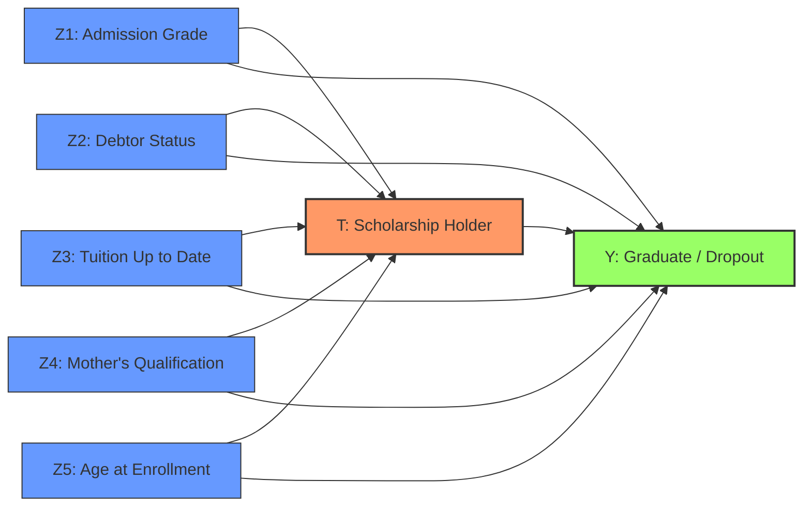

# 01. ĐẶT VẤN ĐỀ NGHIÊN CỨU & THIẾT KẾ ĐỒ THỊ NHÂN QUẢ (PROBLEM FORMULATION & CAUSAL DAG)
> **Dự án:** Causal Bayesian Networks with Deep Learning for Educational Interventions  
> **Bộ dữ liệu:** Predict Students' Dropout and Academic Success (UCI ID: 697)  
> **Trạng thái:** Đã chốt phương án nghiên cứu

---

## 1. Đặt vấn đề Thực tiễn & Ý nghĩa Khoa học

Trong giáo dục đại học, tỷ lệ sinh viên bỏ học (dropout) giữa chừng gây lãng phí nghiêm trọng về nguồn lực xã hội và tương lai của người học. Một trong những công cụ chính sách can thiệp phổ biến nhất của các trường đại học và cơ quan quản lý là **chính sách học bổng và hỗ trợ tài chính**.

Tuy nhiên, trong thực tế quản trị:
* **Ngộ nhận tương quan quan sát:** Sinh viên có học bổng thường có tỷ lệ tốt nghiệp cao hơn sinh viên không có học bổng. Nhưng tương quan này ($P(\text{Graduate} \mid \text{Scholarship}=1) > P(\text{Graduate} \mid \text{Scholarship}=0)$) bị chi phối nặng nề bởi các yếu tố gây nhiễu (Confounders) như: điểm tuyển sinh ban đầu cao hơn, nền tảng gia đình hỗ trợ tốt hơn.
* **Nhu cầu đo lường can thiệp:** Để đưa ra quyết định có nên mở rộng quỹ học bổng hay không, nhà trường cần trả lời câu hỏi can thiệp thực tế: *"Nếu chúng ta can thiệp cấp học bổng cho toàn bộ sinh viên ($do(T=1)$) so với không cấp học bổng ($do(T=0)$), tỷ lệ tốt nghiệp thực sự tăng thêm bao nhiêu sau khi đã triệt tiêu hoàn toàn các sai lệch nền tảng?"*.

---

## 2. Câu hỏi Nhân quả Mục tiêu (Causal Question)

> **Phát biểu chính thức:**  
> *"Dưới các giả định nhận diện Backdoor, việc can thiệp áp đặt chính sách cấp học bổng / hỗ trợ tài chính ($do(T=1)$) tác động như thế nào đến xác suất tốt nghiệp thành công ($Y=1$) của sinh viên đại học so với tình huống không can thiệp ($do(T=0)$)?"*

---

## 3. Không gian Biến số & Từ điển Thuộc tính (Variable Dictionary)

Các biến số được chọn lọc nghiêm ngặt từ bộ dữ liệu UCI ID 697 và phân loại theo trật tự dòng thời gian:

| Tên biến trong Data | Ký hiệu Toán | Ý nghĩa nội dung | Miền giá trị & Mã hóa | Thời điểm đo lường | Vai trò trong Causal DAG |
| :--- | :---: | :--- | :--- | :--- | :--- |
| `Scholarship holder` | **$T$** | Sinh viên có nhận học bổng / hỗ trợ tài chính | $0 = \text{Không}, 1 = \text{Có}$ | Thời điểm nhập học / đầu khóa | **Biến can thiệp (Treatment)** |
| `Target` | **$Y$** | Kết quả học tập cuối khóa | $1 = \text{Graduate (Tốt nghiệp)}, 0 = \text{Dropout (Bỏ học)}$ | Kết thúc khóa học | **Biến kết quả (Outcome)** |
| `Admission grade` | **$Z_1$** | Điểm xét tuyển đầu vào đại học | Rời rạc hóa thành $\{0: \text{Thấp}, 1: \text{TB}, 2: \text{Cao}\}$ | Trước khi nhập học ($t_0$) | **Biến gây nhiễu (Baseline Confounder)** |
| `Debtor` | **$Z_2$** | Tình trạng nợ học phí / tài chính | $0 = \text{Không nợ}, 1 = \text{Đang nợ}$ | Thời điểm nhập học ($t_0$) | **Biến gây nhiễu (Baseline Confounder)** |
| `Tuition fees up to date`| **$Z_3$** | Đóng học phí đầy đủ đúng hạn | $0 = \text{Không}, 1 = \text{Đầy đủ}$ | Đầu khóa học ($t_0$) | **Biến gây nhiễu (Baseline Confounder)** |
| `Mother's qualification`| **$Z_4$** | Trình độ học vấn của mẹ | Nhóm lại: $\{0: \text{Phổ thông}, 1: \text{Đại học/Sau ĐH}\}$ | Trước khi nhập học ($t_0$) | **Biến gây nhiễu (Baseline Confounder)** |
| `Age at enrollment` | **$Z_5$** | Tuổi của sinh viên khi nhập học | Rời rạc hóa: $\{0: \le 20 \text{ tuổi}, 1: > 20 \text{ tuổi}\}$ | Thời điểm nhập học ($t_0$) | **Biến gây nhiễu (Baseline Confounder)** |

*(Lưu ý: Đối với các sinh viên có trạng thái `Enrolled` (vẫn đang học), theo chuẩn bài báo ta lọc ra tập dữ liệu hoàn tất gồm sinh viên đã tốt nghiệp hoặc đã bỏ học để đảm bảo nhãn $Y$ nhị phân rõ ràng).*

---

## 4. Trật tự Thời gian & Thiết kế Đồ thị Causal DAG cho Mô hình B0

### 4.1. Trật tự thời gian (Temporal Ordering)
$$t_0 \ (\text{Nền tảng trước nhập học: } \mathbf{Z}) \quad \prec \quad t_1 \ (\text{Xét duyệt học bổng: } T) \quad \prec \quad t_2 \ (\text{Tốt nghiệp hoặc Bỏ học: } Y)$$

* **Tính hợp lý:**
  * Điểm tuyển sinh $Z_1$, hoàn cảnh kinh tế $Z_2, Z_3$, học vấn phụ huynh $Z_4$ và tuổi $Z_5$ xảy ra trước khi hội đồng xét duyệt học bổng. Do đó các cạnh $Z \rightarrow T$ là hợp lý.
  * Các biến nền $Z$ cũng trực tiếp ảnh hưởng đến năng lực tự học và khả năng duy trì việc học của sinh viên. Do đó các cạnh $Z \rightarrow Y$ là hợp lý.
  * Can thiệp học bổng $T$ cung cấp nguồn lực tài chính giúp sinh viên an tâm học tập, dẫn đến kết quả tốt nghiệp $Y$ ($T \rightarrow Y$).
  * Tuyệt đối không thể có cạnh $Y \rightarrow T$ hoặc $Y \rightarrow Z$ vì vi phạm tính nhân quả thời gian.

### 4.2. Sơ đồ Đồ thị Nhân quả Cơ sở (Domain DAG)

---

## 5. Phân rã Xác suất Đồng thời (Joint Factorization)

Theo tính chất Markov cục bộ trên đồ thị DAG của mô hình B0:
$$P(Z_1, Z_2, Z_3, Z_4, Z_5, T, Y) = \left( \prod_{i=1}^{5} P(Z_i) \right) \cdot P(T \mid Z_1, Z_2, Z_3, Z_4, Z_5) \cdot P(Y \mid T, Z_1, Z_2, Z_3, Z_4, Z_5)$$

Khi thực hiện can thiệp phẫu thuật đồ thị $\text{do}(T = t)$, toàn bộ các cạnh hướng vào $T$ bị triệt tiêu:
$$P(Z_1, \dots, Z_5, Y \mid \text{do}(T = t)) = \left( \prod_{i=1}^{5} P(Z_i) \right) \cdot P(Y \mid T = t, Z_1, \dots, Z_5)$$

---

## 6. Định danh Hình thức (Formal Identification via Backdoor Criterion)

Áp dụng **Tiêu chuẩn Cửa sau (Backdoor Criterion)** của Judea Pearl:
* Tập điều chỉnh hợp lệ là $\mathbf{Z} = \{Z_1, Z_2, Z_3, Z_4, Z_5\}$ vì:
  1. $\mathbf{Z}$ chặn mọi đường đi cửa sau nối giữa $T$ và $Y$ (ví dụ: $T \leftarrow Z_i \rightarrow Y$).
  2. $\mathbf{Z}$ không chứa bất kỳ biến hậu duệ nào của $T$.

Biểu thức can thiệp được định danh thành công về phân phối xác suất quan sát:
$$P(Y = 1 \mid \text{do}(T = t)) = \sum_{\mathbf{z}} P(Y = 1 \mid T = t, \mathbf{Z} = \mathbf{z}) P(\mathbf{Z} = \mathbf{z})$$

**Hiệu ứng can thiệp trung bình (Average Treatment Effect - ATE):**
$$\text{ATE} = P(Y = 1 \mid \text{do}(T = 1)) - P(Y = 1 \mid \text{do}(T = 0))$$

---

## 7. Các Giả định Nhận diện Cốt lõi (Core Causal Assumptions)

1. **Giả định Không có biến gây nhiễu chưa quan sát (No Unmeasured Confounding / Ignorability):**
   $$Y(t) \perp\!\!\perp T \mid \mathbf{Z}, \quad \forall t \in \{0, 1\}$$
   *Ý nghĩa:* Giả định rằng tập biến nền $\mathbf{Z}$ đã thu thập đủ các đặc trưng then chốt (học lực, tài chính, gia đình, tuổi) chi phối việc nhận học bổng và kết quả học tập.
2. **Giả định Tính nhất quán (Consistency):**
   *Nếu sinh viên nhận học bổng ($T = 1$), kết quả quan sát được $Y$ chính là kết quả tiềm năng dưới can thiệp $Y(1)$ ($Y = Y(t)$ khi $T = t$).*
3. **Giả định Tính dương / Bao phủ (Positivity / Overlap):**
   $$0 < P(T = 1 \mid \mathbf{Z} = \mathbf{z}) < 1, \quad \forall \mathbf{z} \text{ mà } P(\mathbf{Z} = \mathbf{z}) > 0$$
   *Ý nghĩa:* Ở mọi tầng sinh viên (theo hoàn cảnh gia đình, học lực), luôn tồn tại xác suất có sinh viên nhận học bổng và có sinh viên không nhận học bổng.
