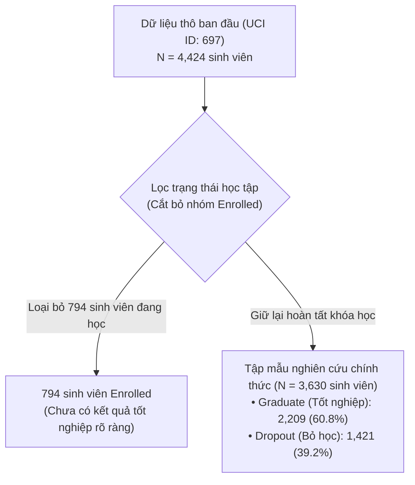

# 02. ĐẶC TẢ CHI TIẾT BỘ DỮ LIỆU UCI ID 697 & KIỂM TOÁN DỮ LIỆU (DATASET SPECIFICATION & AUDIT)
> **Bộ dữ liệu:** Predict Students' Dropout and Academic Success  
> **Nguồn lưu trữ:** UCI Machine Learning Repository (ID: **697**)  
> **Giấy phép (License):** Creative Commons Attribution 4.0 International (CC BY 4.0)  
> **URL:** https://archive.ics.uci.edu/dataset/697/predict+students+dropout+and+academic+success

---

## 1. Thông số Kỹ thuật & Siêu dữ liệu (Metadata)

* **Năm công bố:** 2021 (Realinho et al., Trường Bách khoa Portalegre, Bồ Đào Nha).
* **Số lượng mẫu ban đầu:** 4,424 dòng.
* **Tổng số thuộc tính:** 36 thuộc tính độc lập + 1 cột nhãn mục tiêu (`Target`).
* **Đặc điểm dữ liệu:** Dữ liệu bảng (tabular), kết hợp giữa biến nhân khẩu học, thông tin kinh tế - xã hội và học vấn khi nhập học. Không có giá trị khuyết thiếu (0 missing values trong file gốc).

---

## 2. Kiểm toán Dữ liệu & Quy trình Lọc Mẫu (Data Eligibility Audit)

Thực hiện nghiêm ngặt theo yêu cầu tại **Slide 40**:

### Chi tiết phân bố:
1. **Dữ liệu thô:** 
   * `Graduate`: 2,209 sinh viên (49.9%)
   * `Dropout`: 1,421 sinh viên (32.1%)
   * `Enrolled`: 794 sinh viên (18.0%)
2. **Quy tắc loại trừ:** Sinh viên `Enrolled` vẫn đang trong quá trình học, chưa xác định được kết quả cuối cùng là đỗ hay bỏ học. Việc giữ lại nhóm này sẽ làm mờ nhạt ranh giới can thiệp và vi phạm định nghĩa nhị phân của $Y$. Do đó, loại bỏ 794 dòng này.
3. **Tập mẫu nghiên cứu ($N = 3,630$):**
   * Nhãn mục tiêu $Y$: $Y = 1$ (`Graduate`, 2,209 sinh viên) và $Y = 0$ (`Dropout`, 1,421 sinh viên).
   * Tỷ lệ cân bằng lớp: ~60.8% đỗ vs 39.2% trượt.

---

## 3. Rời rạc hóa & Mã hóa Biến số (Discretization & Encoding)

Để mô hình cơ sở **B0 (Discrete Bayesian Network)** có thể khớp bảng phân phối có điều kiện (CPD) một cách ổn định, các biến liên tục được rời rạc hóa có cơ sở miền tri thức:

| Tên thuộc tính | Kiểu dữ liệu gốc | Phương pháp biến đổi | Miền giá trị sau xử lý |
| :--- | :--- | :--- | :--- |
| `Scholarship holder` ($T$) | Binary (0, 1) | Giữ nguyên nhị phân | $0: \text{Không có học bổng}, \ 1: \text{Có học bổng}$ |
| `Target` ($Y$) | Categorical | Ánh xạ nhị phân | $0: \text{Dropout}, \ 1: \text{Graduate}$ |
| `Admission grade` ($Z_1$) | Continuous [95.0, 190.0] | Phân nhóm 3 mức theo ngưỡng tuyển sinh | $0: < 120 \ (\text{Thấp}), \ 1: 120-140 \ (\text{TB}), \ 2: \ge 140 \ (\text{Cao})$ |
| `Debtor` ($Z_2$) | Binary (0, 1) | Giữ nguyên nhị phân | $0: \text{Không nợ học phí}, \ 1: \text{Đang nợ học phí}$ |
| `Tuition fees up to date` ($Z_3$)| Binary (0, 1) | Giữ nguyên nhị phân | $0: \text{Chậm/Nợ học phí}, \ 1: \text{Đóng đúng hạn}$ |
| `Mother's qualification` ($Z_4$)| Categorical (1–44) | Gom nhóm trình độ | $0: \text{Phổ thông / Dưới THPT}, \ 1: \text{Đại học / Sau ĐH}$ |
| `Age at enrollment` ($Z_5$) | Integer [17, 70] | Phân nhóm độ tuổi sinh viên | $0: \le 20 \text{ tuổi (Độ tuổi chuẩn)}, \ 1: > 20 \text{ tuổi (Lớn tuổi)}$ |

---

## 4. Kiểm toán Chống Rò rỉ Dữ liệu (Data Leakage Prevention)

Theo nguyên tắc tại **Slide 40**:
* **Cảnh báo quan trọng:** Bộ dữ liệu chứa các biến kết quả học tập kỳ 1 và kỳ 2 (như `Curricular units 1st sem (grade)`, `Curricular units 2nd sem (grade)`).
* **Quy tắc xử lý:** Tuyệt đối **KHÔNG** đưa điểm số kỳ 2 vào tập biến nền $\mathbf{Z}$ vì các biến này diễn ra sau khi học bổng đã được cấp phát. Nếu đưa điểm kỳ 2 vào tập điều chỉnh, chúng sẽ đóng vai trò là **Biến trung gian (Mediator)** hoặc **Collider**, làm triệt tiêu dòng nhân quả trực tiếp của học bổng và gây thiên lệch nghiêm trọng (Mediator/Collider bias).
* Chỉ sử dụng điểm tuyển sinh đầu vào `Admission grade` ($Z_1$) làm chỉ số năng lực tiên nghiệm.

---

## 5. Kiểm toán Tính Bao phủ Can thiệp (Treatment Overlap / Positivity Check)

Kiểm tra số lượng mẫu và tỷ lệ nhận học bổng ($T=1$) trên tập dữ liệu đã lọc ($N=3,630$):
* Tổng số sinh viên nhận học bổng ($T=1$): ~900 sinh viên (~24.8%).
* Tổng số sinh viên không nhận học bổng ($T=0$): ~2,730 sinh viên (~75.2%).
* Trong mọi phân tầng chính (như nhóm điểm tuyển sinh cao/thấp, nhóm tuổi), luôn tồn tại cả sinh viên có học bổng và không có học bổng, đảm bảo thỏa mãn giả định tính dương:
  $$0 < P(T = 1 \mid \mathbf{Z} = \mathbf{z}) < 1$$

---

## 6. Giao thức Phân chia Dữ liệu (Train / Val / Test Splits)

Theo chuẩn thực nghiệm đối sánh tại **Slide 18 & 41**:
* **Tỷ lệ phân chia:**
  * **Tập Huấn luyện (Train):** 70% (~2,541 mẫu).
  * **Tập Kiểm định (Validation):** 15% (~545 mẫu) — dùng để chọn checkpoint mạng nơ-ron H1 và ngưỡng cắt cạnh H2.
  * **Tập Kiểm thử (Test):** 15% (~544 mẫu) — **giữ nguyên vẹn tuyệt đối**, chỉ nạp vào ở bước tính điểm cuối cùng.
* **Phân tầng (Stratification):** Phân chia giữ nguyên tỷ lệ nhãn $Y$ và biến can thiệp $T$.
* **5 Hạt giống ngẫu nhiên ghép cặp (5 Paired Seeds):**
  $$\text{Seeds} = [42, \ 123, \ 456, \ 789, \ 999]$$
* **Nguyên tắc đóng băng tiền xử lý:** Toàn bộ bảng gom nhóm, rời rạc hóa và mã hóa chỉ được `fit` trên tập Train của từng seed, sau đó áp dụng (transform) sang Validation và Test.
