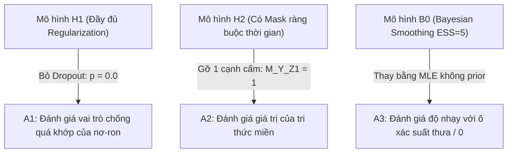

# 03. KIẾN TRÚC KỸ THUẬT MÔ HÌNH B0, H1, H2 VÀ BIẾN THỂ BÓC TÁCH (MODEL ARCHITECTURE & ABLATIONS)
> **Dự án:** Causal Bayesian Networks with Deep Learning for Educational Interventions  
> **Nguyên tắc cốt lõi:** Đối sánh kiểm soát chặt chẽ (Controlled Comparison) và bóc tách đơn biến ("One change only")  
> **Slide tham chiếu:** Slide 18–22, 43–51, 62  

---

## 1. Tổng quan Hệ thống 3 Mô hình Chính & Mở rộng

| Mô hình | Đồ thị nhân quả (DAG) | Ước lượng phân phối có điều kiện (CPD) | Mục tiêu kiểm chứng |
| :--- | :--- | :--- | :--- |
| **B0 (Baseline CBN)** | **Domain DAG** (Chuyên gia thiết kế) | Non-neural CPDs: **Bayesian Smoothing** (tiên nghiệm BDeu, $ESS = 5$) | Mốc tham chiếu nền tảng chuẩn mực |
| **H1 (Neural CPD)** | **Cố định Domain DAG** của B0 | **Mạng nơ-ron sâu (MLP)** cho $P(Y \mid \text{Parents}(Y))$ | Cô lập đóng góp của việc xấp xỉ hàm phi tuyến |
| **H2 (Neural DAG)** | **Học bằng Gradient** (DAG-GNN/NOTEARS) kèm **Domain Mask** | Non-neural CPDs (cùng họ Bayesian Smoothing như B0) | Cô lập đóng góp của việc học cấu trúc tự động |
| **H1+H2 (Mở rộng)** | **DAG học được từ H2** | **CPD nơ-ron từ H1** trên cấu trúc mới | Đánh giá sức mạnh tổng hợp của cả cấu trúc và tham số |

---

## 2. Chi tiết Cài đặt Mô hình Cơ sở B0 (Baseline CBN)

1. **Cấu trúc Đồ thị:**
   * Tập đỉnh $\mathbf{V} = \{Z_1, Z_2, Z_3, Z_4, Z_5, T, Y\}$.
   * Tập cạnh $\mathbf{E} = \{(Z_i \rightarrow T), (Z_i \rightarrow Y) \mid i \in [1, 5]\} \cup \{(T \rightarrow Y)\}$.
2. **Ước lượng Tham số (CPD Fitting):**
   * Sử dụng thư viện `pgmpy.models.DiscreteBayesianNetwork`.
   * Bộ ước lượng: `pgmpy.estimators.BayesianEstimator` với tiên nghiệm BDeu (Bayesian Dirichlet equivalent uniform):
     $$P(X_i = k \mid \text{Pa}(X_i) = j) = \frac{N_{ijk} + \alpha / (r_i \cdot q_i)}{N_{ij} + \alpha / q_i}$$
     với $\alpha = 5$ (tương đương cỡ mẫu giả định $ESS = 5$), $r_i$ là số trạng thái của $X_i$, $q_i$ là số cấu hình của cha mẹ.
3. **Suy diễn Can thiệp:**
   * Sử dụng thuật toán Khử biến (Variable Elimination).
   * Tính toán $P(Y = 1 \mid \text{do}(T = 0))$ và $P(Y = 1 \mid \text{do}(T = 1))$ theo công thức hiệu chỉnh Backdoor.

---

## 3. Chi tiết Cài đặt Mô hình Lai H1 (Neural Mechanism Estimation)

1. **Nguyên lý:** Giữ nguyên 100% đồ thị của B0, chỉ thay thế hàm ánh xạ từ các biến cha mẹ vào biến kết quả $Y$.
2. **Kiến trúc Mạng Nơ-ron (PyTorch):**
   * **Đầu vào (Input):** Vector one-hot đại diện cho cấu hình của $\text{Parents}(Y) = \{T, Z_1, Z_2, Z_3, Z_4, Z_5\}$.
   * **Cấu trúc tầng (Layers):**
     $$\text{Input} \xrightarrow{} \text{Linear}(d_{\text{in}}, 32) \xrightarrow{} \text{ReLU} \xrightarrow{} \text{Dropout}(p=0.2) \xrightarrow{} \text{Linear}(32, 16) \xrightarrow{} \text{ReLU} \xrightarrow{} \text{Linear}(16, 1) \xrightarrow{} \text{Sigmoid}$$
   * **Hàm mất mát (Loss):** Binary Cross-Entropy (BCE).
   * **Tối ưu hóa (Optimizer):** Adam ($\text{lr} = 0.001$, $\text{weight\_decay} = 10^{-4}$).
   * **Dừng sớm (Early Stopping):** Theo dõi hàm mất mát trên tập Validation (patience = 10 epochs), lưu lại checkpoint tốt nhất.
3. **Tái tích hợp vào Mạng Bayes:**
   * Đưa toàn bộ các tổ hợp trạng thái có thể có của $\text{Parents}(Y)$ qua mạng để thu về vector xác suất $P_\theta(Y = 1 \mid \text{Parents}(Y))$.
   * Chuẩn hóa và tạo bảng `TabularCPD` của `pgmpy`, thay thế vào bản sao đồ thị B0.
   * Thực thi lệnh can thiệp $\text{do}(T=t)$ trên mạng Bayes này.

---

## 4. Chi tiết Cài đặt Mô hình Lai H2 (Gradient-based Neural DAG Learning)

1. **Nguyên lý:** Chuyển bài toán tìm đồ thị tổ hợp rời rạc thành bài toán tối ưu gradient liên tục trên ma trận trọng số $W \in \mathbb{R}^{d \times d}$.
2. **Hàm mục tiêu có Ràng buộc Phi chu trình:**
   $$\min_{W} \mathcal{L}(W; \mathbf{X}_{\text{train}}) + \lambda \|W\|_1 \quad \text{sao cho} \quad h(W) = \text{tr}\left(e^{W \odot W}\right) - d = 0$$
3. **Ma trận Mặt nạ Ràng buộc Miền (Domain Mask $M \in \{0, 1\}^{d \times d}$):**
   * Để khắc phục tính tương đương Markov và ép đồ thị tuân thủ trật tự thời gian, thiết lập ma trận $M$:
     $$W_{\text{eff}} = M \odot W$$
   * **Quy tắc cấm cạnh (Đặt $M_{ij} = 0$):**
     * Cấm cạnh từ biến kết quả sang biến khác: $M_{Y, T} = 0$ và $M_{Y, Z_k} = 0, \forall k$.
     * Cấm cạnh từ biến can thiệp ngược về biến nền: $M_{T, Z_k} = 0, \forall k$.
     * Cấm cạnh tự khuyên: $M_{ii} = 0, \forall i$.
4. **Hậu xử lý & Tái định danh:**
   * Áp dụng ngưỡng cắt cạnh: Giữ lại các cạnh có $|W_{\text{eff}, ij}| \ge \tau$ (ví dụ $\tau = 0.3$).
   * Kiểm tra tính phi chu trình (Acyclicity check) và sửa chu trình nếu phát sinh.
   * Đưa đồ thị học được vào `DoWhy` để tái nhận diện công thức Backdoor.
   * Khớp bảng CPD bằng `BayesianEstimator` (tiên nghiệm BDeu, $ESS = 5$) giống hệt B0 để cô lập chính xác đóng góp của cấu trúc.

---

## 5. Ba Biến thể Bóc tách (Ablations A1–A3) — Quy tắc "One Change Only"

Theo quy định tại **Slide 21 & 48–51**:

### Chi tiết 3 phép bóc tách:
1. **A1 (Bóc tách từ H1):**
   * *Thay đổi duy nhất:* Đặt `dropout = 0.0` và bỏ $L_2$ weight decay. Giữ nguyên kiến trúc mạng, siêu tham số học và dữ liệu.
   * *Mục đích:* Đo lường mức độ quá khớp (overfitting) của mạng nơ-ron khi không có điều chuẩn đối với việc ước lượng rủi ro can thiệp.
2. **A2 (Bóc tách từ H2):**
   * *Thay đổi duy nhất:* Cho phép đúng 1 cạnh cấm thời gian (ví dụ mở $M_{Y, Z_1} = 1$), giữ nguyên thuật toán học đồ thị.
   * *Mục đích:* Kiểm tra xem nếu thiếu tri thức miền, thuật toán học đồ thị có bị lạc hướng học ra cạnh ngược thời gian hay không.
3. **A3 (Bóc tách từ B0):**
   * *Thay đổi duy nhất:* Thay thế `BayesianEstimator` bằng `MaximumLikelihoodEstimator` thuần túy (không cộng pseudo-counts).
   * *Mục đích:* Đánh giá độ nhạy của mô hình khi gặp các nhóm đối tượng hiếm (sparse cells) và nguy cơ sinh ra xác suất bằng 0.

---

## 6. Thiết kế Kiểm định Bác bỏ Nhân quả (DoWhy Refutation Checks)

Theo quy định tại **Slide 13 & 54**:
1. **Placebo Treatment Refuter (`placebo_treatment_refuter`):**
   * Hoán vị ngẫu nhiên nhãn can thiệp $T$ (100 lần mô phỏng).
   * *Kỳ vọng:* Hiệu ứng nhân quả mới phải tiến sát về $0$ ($p\text{-value} > 0.05$). Nếu hiệu ứng vẫn lớn, chứng tỏ mô hình đang bắt tương quan giả.
2. **Data Subset Refuter (`data_subset_refuter`):**
   * Lấy mẫu ngẫu nhiên 80% dữ liệu (100 lần mô phỏng).
   * *Kỳ vọng:* Giá trị ATE ước lượng lại phải giữ ổn định quanh giá trị ATE ban đầu.
3. **Mô phỏng DoWhy GCM (Graphical Causal Model):**
   * Khởi tạo mô hình GCM, áp đặt can thiệp nguyên tử $do(T = t)$, sinh 20,000 mẫu mô phỏng và tính rủi ro kết quả để đối soát chéo với kết quả truy vấn giải tích của CBN.
